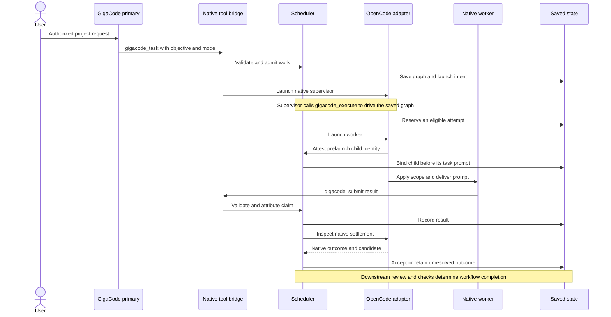
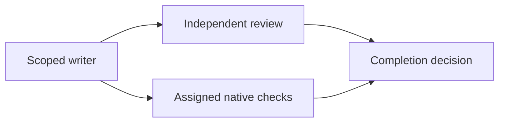

# Agent coding workflows

GigaCode chooses a graph proportional to the request, then runs it through native OpenCode sessions. A focused investigation can use one planner; a small implementation can start directly with a writer, independent reviewer and verifier. Research, critique and synthesis are additional work only when the task or an explicit recipe needs them.

The [architecture guide](architecture.md) explains the components and trust boundaries. This guide follows the work from admission through verification and recovery.

GigaCode uses fresh configuration in `gigacode.json` and run state in `.gigacode/`. Previous products' settings, permission identifiers and histories are not imported. Native OpenCode permissions still govern current GigaCode work, and GigaCode retains its own history for inspection and recovery.

## From a request to native work

GigaCode can answer ordinary explanations and configuration questions with read tools. Starting a project workflow requires an authorized task. `gigacode_task` captures its objective and mode; an optional `workflow` supplies task purposes and dependencies, while the engine supplies the immutable request and configured check criteria.

Before admission, GigaCode captures the initiating model and permissions, validates the graph and model choices, and rechecks the initiating context for an agent/model/permission change. Replay of the same native call cannot launch a second run or change its request. A conversation with active work must use controls for that run instead of admitting another.



The supervisor is a native model session, but it does not implement a second scheduling algorithm. `Engine.drive` and `Engine.tick` select work, maintain reservations and reconcile outcomes.

## Plan and execute modes

| Entry | Behavior |
| --- | --- |
| `gigacode_task` with `mode: "plan"` | Run read-only work and stop ready with a report or saved proposal. |
| `gigacode_task` with `mode: "execute"`, without a graph | Begin with a planning worker, then admit a validated execution proposal within the authorized request. |
| `gigacode_task` with `mode: "execute"` and a graph | Start the admitted implementation graph directly. |
| `/gigacode run <run-id>@<revision>` | Execute the exact saved proposal after checking authorization, revision and workspace freshness. |

Selecting execute mode authorizes implementation within the captured scope; native permission asks and denies still apply. Finishing a plan never establishes that implementation occurred.

## A small coding change

For a bounded change whose relevant code has already been inspected, the direct graph is:



Review and verification can run independently after the writer, subject to configured capacity. Both inspect the final candidate rather than treating the writer's summary as proof.

For example, this primary-agent tool input describes a direct queue fix. It assumes a configured check named `test`; check IDs must come from the effective project configuration.

```json
{
  "objective": "Fix equal-priority queue ordering while preserving the public API and add a regression test.",
  "mode": "execute",
  "workflow": {
    "rationale": "The affected queue implementation and tests are known; independent review and the configured test check cover the candidate.",
    "tasks": [
      {
        "id": "implement",
        "title": "Fix queue ordering",
        "role": "implementer",
        "stage": "implementation",
        "instructions": "Implement the requested ordering change and regression within the owned files.",
        "dependencies": [],
        "writes": true,
        "ownedPaths": ["src/queue.ts", "tests/queue.test.ts"]
      },
      {
        "id": "review",
        "title": "Review ordering and compatibility",
        "role": "reviewer",
        "stage": "review",
        "instructions": "Inspect ordering, public API compatibility and regression coverage against the objective.",
        "dependencies": ["implement"],
        "writes": false
      },
      {
        "id": "verify",
        "title": "Run configured tests",
        "role": "verifier",
        "stage": "verification",
        "instructions": "Run the assigned test check through gigacode_check and assess verification coverage.",
        "dependencies": ["implement"],
        "writes": false,
        "checkIds": ["test"]
      }
    ]
  }
}
```

Direct execution admission requires scoped writers, independent review and final configured verifiers following every writer. Model overrides are optional and must be authorized; omission lets the configured stage/role/default selection apply. Workers cannot add arbitrary new agents themselves.

## Work that needs an initial failing test

When a regression needs test-first evidence, use a test writer, a baseline verifier, an implementation writer, and final independent review and verification. Assign the baseline verifier its exact configured `checkIds` just like the final verifier.

An expected RED result is an actual failed native check recorded before the fix. It must remain failed evidence in history. The implementation task uses the baseline dependency with `acceptsFailures: true` when it must proceed despite that failure. Later tasks should depend on the baseline where its evidence is needed.

Final review and passing checks must follow every writer, including the test writer and implementation writer. A baseline pass or earlier repair check cannot replace final proof, even when a later writer leaves file hashes unchanged. Writers do not run commands themselves.

## Read only recipes

Recipes provide fixed investigation structures through the same scheduler and permission rules. They require plan mode and cannot be combined with an authored workflow.

| Recipe | Independent work | Reconciliation |
| --- | --- | --- |
| `deep-review` | Behavior/compatibility review and failure/regression review. | A synthesizer reconciles actionable findings. |
| `bug-investigation` | Execution-path tracing and competing-cause/regression analysis. | A planner explains the root cause and fix strategy. |
| `cross-checked-research` | Primary-contract research and contrary/version evidence research. | A synthesizer explains the supported contract and uncertainty. |

For example:

```text
/gigacode plan --recipe cross-checked-research Establish the timeout and retry contract for the pinned API version.
```

A report can finish ready without proposing execution. Implementing its recommendations needs a new authorized execution request or an explicitly executable saved proposal; a report alone grants no write authority.

## Checks and acceptance

A verifier calls `gigacode_check({checkId: "test"})`. The adapter looks up the saved command, attests the calling worker and invocation, and executes through the native permission-checked shell wrapper. It records the exit status and candidate fingerprint. If the workspace changes during a check, its outcome becomes unknown.

The verifier then submits its observed result. It cannot convert a failed command into a passing check by changing its summary or assessment. Similarly, an implementer submission is not independent review and does not satisfy requirement assessments merely by claiming the work is complete.

The engine evaluates current review, configured checks, required criteria and unresolved findings together. Successful native checks establish the behavior covered by those commands. A missing boundary case can still escape weak tests and a mistaken reviewer, so completion is not a proof of all semantic correctness.

## Bounded repair

A repair appends three new tasks: a writer that consumes previous evidence, a reviewer of the repaired candidate, and a verifier assigned the configured checks. It retains the original criteria and already admitted file scope. Earlier failed attempts remain visible rather than being rewritten as success.

`repairRounds`, attempts, steps and time limits bound the work. Missing writer scope, exhausted budgets or unresolved proof prevent automatic success. Repair revisions use their own current review and check evidence; old passing results do not silently satisfy them.

## Independent writers in Git worktrees

With `parallelWrites: true`, at least two independent writers can receive isolated native locations. The initial implementation requires a clean committed canonical Git root, disjoint supported text changes, and no unsupported submodules or Git filters.

A generated preparation worker creates the recorded checkouts through fixed native Git commands with hooks disabled. Each writer is moved and receives destination restrictions before its task prompt. The adapter captures accepted changes, a serial integration worker applies them to the root, and final review and checks follow integration.

Dependent writing sequences, overlapping changes and unsupported changes are refused. Failed or uncertain checkouts remain inspectable; they are not force-removed. Keep external root edits settled while integration is awaiting native permission, because the write primitive does not offer an atomic compare-and-write operation.

## Pause recovery and cancellation

| State or control | Meaning |
| --- | --- |
| `waiting_input` | Work needs a user answer or explicit continuation after an uncertain/stopped driver. |
| Task or attempt `waiting_permission` | Native permission is pending; its worker keeps its reservation. |
| Run `waiting_budget` | A context, attempt or run-time allowance prevents more work. Inspect the recorded reason before changing a limit. |
| `recovering` | Recorded native sessions are being reconciled; an unknown launch cannot be retried as if it never happened. |
| `pause` | Drain active work toward a settled paused state. |
| `cancel` | Request native interruption and retain state until settlement is established. |
| `retry` | Retry an eligible settled failed attempt after freshness and dependent-session checks. |

`resume` uses the existing run and creates a fresh launch intent when appropriate. Recovery preserves accepted predecessor results and never repeats successful investigation just to reconstruct a transcript. Switching the visible primary agent does not cancel a run or remove its coordinator restrictions.

Inspect the exact run before retrying or increasing a budget. Use `/gigacode inspect <run-id> [task-id]` for details and `/gigacode export <run-id>` for saved reports. Unknown native outcomes and missing durable state require reconciliation, not fabricated results or direct edits to `.gigacode`.

## Developing a workflow change

Keep graph admission, capability enforcement and evidence acceptance consistent when adding a role or task shape. Use the [architecture change map](architecture.md#where-changes-belong) to find the relevant modules, then run the deterministic and native checks in the [README](../README.md#verification-and-source-map).

Use the opt-in model evaluation runner only with an explicit model and runtime/cost allowance. Its independent fixture assertions help expose results that look plausible but violate the requested contract. Native scripted integration tests verify the execution machinery; model evaluations address a different question about the selected model's output.
