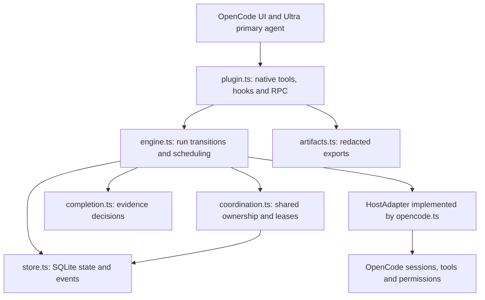

# Agent coding architecture

Ultra turns an authorized coding request into a saved graph of native OpenCode agents. The primary agent interprets the request, specialists produce changes and evidence, and a deterministic engine decides what may run next and whether the recorded work meets the completion rules.

The central distinction is between a model's claim and an observed result. A submitted result belongs to one worker attempt; accepting it also requires native session settlement. Execution success additionally requires independent review, supported requirement assessments and fresh configured checks. These rules make the process inspectable; correctness still depends on the model's reasoning and the coverage of the checks.

For worked examples, see [Agent coding workflows](agent-workflows.md). The [design record](design.md) contains historical decisions, compatibility results and known incidents; this guide describes the current implementation.

## Runtime components

OpenCode owns model execution, sessions, native tools and permission decisions. Ultra supplies the task graph, capability restrictions, saved evidence and scheduling policy. The adapter joins those systems through OpenCode's existing native interfaces.

`plugin.ts` is the composition root: it creates the store, engine and adapter, registers tools and hooks, and owns their disposal. It checks the supported host version before creating runtime state. `index.ts` exports this plugin; `tui.ts` is the separate terminal companion and uses the plugin's RPC control plane.

`engine.ts` owns state transitions and calls the `HostAdapter` interface. Its mutations use project ownership and store generation checks. Keeping these transitions together makes admission, cancellation, repair and recovery use the same concurrency rules.

`completion.ts` reads a saved run snapshot and returns a terminal or repair decision. It has no database access or host operations. `coordination.ts` manages the shared lease record and heartbeat through the `Store` interface. `store.ts` implements atomic state changes and audit persistence in SQLite. These boundaries let the engine tests exercise scheduling without an OpenCode process, while native tests verify the adapter contract.

## Agents and capabilities

The visible primary agent is `ultra`. The two dedicated native subagents are `ultra-supervisor` and `ultra-worker`. Worker roles are task capabilities and instructions applied to the worker session; they are not separate installed agent definitions for every specialist.

| Participant | Responsibility | Capability boundary |
| --- | --- | --- |
| Ultra primary | Understand the request, select a proportionate graph and explain accepted results. | Reads and workflow controls; project edits and commands go through workers. |
| Supervisor | Call `ultra_execute` to drive the bound run. | The engine chooses eligible work; the supervisor has no project editing or general shell capability. |
| Explorer and researcher | Inspect code, contracts and sources. | Read-only tools; no commands or additional delegation. |
| Planner and synthesizer | Develop or reconcile a design and assess its coverage. | Read-only; a design-stage planner or synthesizer may propose an execution graph. |
| Implementer | Change the authorized files and report the actual work. | Writes only within admitted `ownedPaths`; general shell and test execution are unavailable. |
| Reviewer | Independently inspect the candidate and report findings. | Read-only; review does not execute checks or edit the candidate. |
| Verifier | Execute assigned configured checks and assess verification coverage. | `ultra_check` accepts only the task's explicit `checkIds`; raw shell is hidden. |

Generated preparation and integration tasks are special implementers. They expose fixed `ultra_prepare` or `ultra_integrate` operations for the run's recorded Git changes. They do not accept arbitrary commands or destinations from the model.

Tool visibility and execution authorization are separate controls. [The adapter](../src/opencode.ts) selects visible tools, attests invocation and session identities, and checks authorized wrappers. [The policy module](../src/policy.ts) intersects native permission decisions with the captured user rules, role and path scope. An existing native ask or deny cannot become an allow through Ultra. Repository text and predecessor results cannot grant permission.

These controls use native tool and permission boundaries. Configured commands execute with the host process's operating-system access; Ultra does not add an operating-system sandbox around project test scripts.

## Saved data and provenance

The [domain types](../src/types.ts) separate the requested work from each execution of that work.

| Record | Meaning |
| --- | --- |
| `Run` | The objective, immutable required criteria, captured authorization and model, configuration, task history and lifecycle state. |
| `Plan` | A revision of the task graph, its criteria and rationale. A saved proposal does not itself authorize execution. |
| `TaskSpec` | A task's purpose, role, stage, dependencies, file ownership and assigned checks. |
| `Task` | The specification together with its status, attempts and accepted attempt ID. |
| `Attempt` | One dispatch attempt, including its input hash, rendered prompt, model selection, native session identity, result and checks. |
| `CheckEvidence` | A native command's identity, configured check, exit status, outcome, timing and workspace fingerprint. |
| `DependencyResult` | A captured predecessor task, attempt and result hash used by a consumer. |

An attempt is reserved before dispatch. OpenCode's prelaunch callback then supplies the real child identity, which Ultra binds before admitting the task prompt. Model-generated session IDs cannot establish that binding. The input hash covers the task inputs, criteria, authorization, model, configuration and prompt version.

Worker submission is a two-step boundary. `results.ts` validates the structured payload; `Engine.submit` validates its attribution, criterion IDs and any proposal. The result is a claim until reconciliation observes native success. An interrupted session, an unknown outcome or a successful session without an attributable result cannot silently become an accepted success.

The canonical project stores state at `.ultracode/state.sqlite`, using SQLite WAL mode. Runs, events and leases have separate tables. State mutations use synchronous transactions, optimistic generations and lease epochs. Within a process, location instances and plugin reloads share a coordination record keyed by project and database path. The lease lasts 30 seconds and its heartbeat renews every five seconds. Separate processes contend through database fencing; this is not a distributed scheduler.

Workspace and candidate hashes come from [the manifest](../src/workspace.ts), which excludes runtime state and dependencies. They identify the candidate within that manifest's coverage, rather than claiming to capture every file on the machine.

## Scheduling and completion

The scheduler reconciles native sessions before selecting more work. It respects dependencies, writer reservations, worker capacity, steps, attempts and time limits. Uncertain native outcomes retain their reservations until reconciliation establishes what happened. A retry must not duplicate work that may already be running.

Planning completion requires passing assessments of the original required planning criteria and no unresolved blocking critique. A plan request stops at `ready`. Execution of its saved proposal requires explicit authorization and the exact saved revision, with a fresh workspace. A report-only recipe can finish ready without an execution proposal.

Execution completion in [completion.ts](../src/completion.ts) requires all of the following:

- Current independent review after every writer, against the current workspace.
- Fresh assigned verifier evidence against the candidate, with the latest outcome for each required configured check passing at exit zero.
- Coverage of every required criterion, including a required machine-check criterion, with no conflicting failed assessment.
- No unresolved blocking findings or failed current work; a parallel run must also have completed its recorded integration.

Review and native checks serve different purposes. A passing command cannot settle an unresolved contract finding, and a reviewer's statement that tests passed cannot replace native command evidence. With no configured native checks, a reviewed candidate remains partial rather than claiming verified execution success.

Repairs preserve history and append a bounded writer, reviewer and verifier graph. The repair writer receives only the union of already admitted writer paths. Final proof must follow the current repair writers; an earlier passing check cannot establish completion just because the file hash stayed the same.

## Context and model selection

[Configuration](../src/config.ts) resolves models from authorized task overrides, stage and role settings, defaults, then the initiating model. Model and variant are captured together. Unavailable models, invalid variants and known lack of tool support are rejected without selecting another model.

[The guided editor](../src/settings-ui.ts) owns scope, drafts and confirmation. Separate [model](../src/settings-models-ui.ts), [limit](../src/settings-limits-ui.ts) and [check](../src/settings-checks-ui.ts) forms use native dialogs; [presentation](../src/settings-presentation.ts) provides labels and concrete previews. Scope selection never copies a project draft into global defaults. Leaving a changed draft requires explicit discard. Navigation, replacement command feedback, reconnect and disposal retire the request and retained callbacks.

[Project persistence](../src/settings.ts) resolves the native and project layers. [Global persistence](../src/global-settings.ts) identifies a unique Ultra registration in the active native profile using the host's package metadata and server environment. Global snapshots return Ultra settings without unrelated native credentials. JSONC edits preserve comments, other plugins and unrelated options. [Shared validation](../src/settings-values.ts) limits editable fields and checks changed model references against the live catalogue. [File persistence](../src/settings-file.ts) queues writes by target path, including across project instances, backs up originals and replaces files atomically. Temporary files stay outside fingerprinted source. A final synchronous guard checks cancellation and settled workflows before replacement. Optimistic revision checks detect observed external edits; they do not lock independent processes or external editors.

The plugin validates the initiating primary session and uses project ownership during saves. Project saves update the existing engine configuration object, so future admissions in that location capture the new values without restarting. Global saves require a native reload to apply across projects, preserving native precedence and project overrides. Persisted run snapshots remain unchanged. A changed project configuration file can invalidate a saved plan's candidate fingerprint. These RPC methods are UI controls, are not exposed as model tools and make no model calls.

[Worker prompts](../src/workflow.ts) retain the objective, criteria, clarifications, task instructions, capabilities and check assignments. Generated task purposes avoid repeating the objective. Submission schemas expose only relevant fields: implementers omit assessments, other roles receive actual assessment IDs, and only eligible design roles receive the proposal schema.

The handoff must fit both `limits.contextChars` and, when metadata is available, [an estimated model allowance](../src/context.ts). The allowance uses UTF-8 bytes conservatively against advertised token capacities, reserving output and native overhead. It is not a tokenizer measurement or a bound on all later native conversation history.

Dependency summaries are shortened with explicit captured references. Aggregate fallback reduces them first to brief previews and then to references alone before refusing mandatory context. `ultra_dependency` retrieves immutable captured results in bounded pages, validating their hashes. Omitted evidence remains uninspected until the worker retrieves or independently examines it.

Check logs and routine inspection use bounded model-facing previews. Saved check output retains its existing 100,000-character limit, and exports retain the saved records. If mandatory context still cannot fit, the engine stops before creating a worker attempt and records `waiting_budget` or drains active work toward that state. It does not clip the objective or weaken criteria.

For local/free configurations, the [local profile](../examples/ultracode-local.json) keeps Ultra roles and stages inherited and limits concurrency. Native title, summary and compaction settings also affect model use; selecting a local worker alone does not configure those host agents. Provider compatibility and model quality remain separate from context size.

## Native boundaries and lifecycle

`opencode.ts` is the native gateway. Launch requires a genuine tool invocation, records parent/child ancestry, installs the captured permission baseline and restrictions, and verifies placement before prompting an isolated writer. It also reconciles outcomes, interrupts workers, publishes completion notices and records checks.

[RPC](../src/rpc.ts) provides controls and read views for clients. It does not invent the `ToolContext` required for dispatch. Command starts and resumptions can enqueue a saved launch intent; native tool execution must consume and bind that intent before driving work. Mutating controls remain tied to the initiating conversation and location.

[Resource cleanup](../src/lifecycle.ts) aborts admission, drains in-flight callbacks, waits for observation to stop, disposes registrations in reverse order and closes storage. Retiring sessions retain restrictions during shutdown. Recovery inspects recorded native identities before continuing; it does not recreate children from transcript claims.

The adapter's native execution bridge relies on tested OpenCode API behavior and source ordering. Compatibility is therefore gated by [exact supported versions](../src/compatibility.ts); changing a version string is not a substitute for running the compatibility and production suites.

## Reports and failure boundaries

[Artifacts](../src/artifacts.ts) produce JSON, Markdown and a read-only HTML dashboard. [Redaction](../src/redaction.ts) removes recognizable credential patterns from observations and exports; it is not an exhaustive secret scanner. Native event history is incomplete, so exports do not claim exact replay or access to private model reasoning.

Storage is a runtime availability dependency. The recorded SQLite I/O incident caused prompt hooks to return HTTP 500 while reading saved bindings. The module refactor did not establish its root cause or fix it. Do not treat the live SQLite database or its WAL/SHM files as scratch files, or recreate missing state to turn an uncertain worker into an unbound session. `.spike/` contains ignored development experiments; `.ultracode/` contains operational state needed for recovery.

The [validation record](design.md) distinguishes native runtime tests from real-model evaluations. In particular, successful worker submissions did not make the tested local 4B candidate semantically correct. Keep model-quality claims separate from the evidence and permission contracts above.

## Where changes belong

| Change | Main files and checks |
| --- | --- |
| New graph fields or admission rules | `types.ts`, `results.ts`, `graph.ts`; graph and engine tests. |
| Agent instructions or handoff format | `agents.ts`, `workflow.ts`, `recipes.ts`; prompt and agent-mode tests. Bump the worker prompt version when its contract changes; preserve custom primary text when migrating exact bundled defaults. |
| New native operation or capability | `plugin.ts`, `opencode.ts`, `policy.ts`; permission, attribution and native integration tests. Hiding a tool alone is insufficient. |
| New lifecycle or scheduling rule | `engine.ts`, `coordination.ts`, `completion.ts`; engine, store, lifecycle and recovery tests. |
| Persistence or report changes | `store.ts`, `redaction.ts`, `artifacts.ts`, `workflow-view.ts`; store, artifact and view tests. |
| Client controls or terminal views | `rpc.ts`, `agent-control.ts`, `tui.ts`; RPC/schema, agent-mode and terminal tests. |
| Guided models, limits or checks | `settings-ui.ts` for scope/drafts, `settings-*-ui.ts` for forms, `settings-presentation.ts` for labels/previews; terminal tests. |
| Configuration values or storage | `config.ts` and `settings-values.ts` for validation; `settings.ts` and `global-settings.ts` for layers/targets; `settings-file.ts` for atomic writes; `native-config.ts` shares installer targeting/parsing. Settings, installer, lifecycle and native integration tests cover these boundaries. |

Use the [README verification commands](../README.md#verification-and-source-map). Unit tests cover deterministic policy; native integration exercises actual tool and session behavior; opt-in model evaluations check a selected model separately. On macOS, canonical temporary paths such as `TMPDIR=/private/tmp` avoid the runtime metadata guard rejecting `/var` aliases in fixtures.
