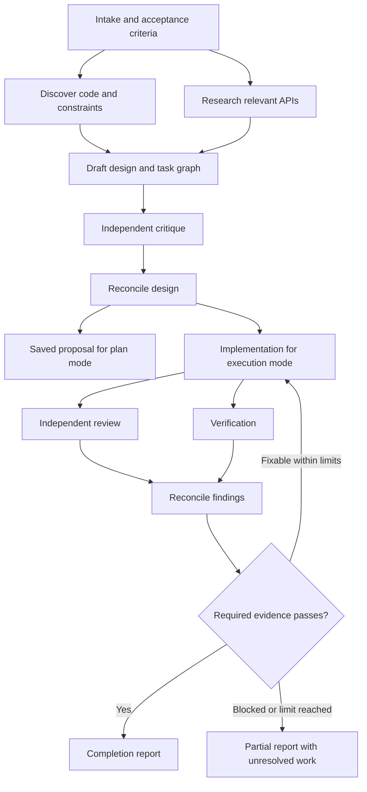
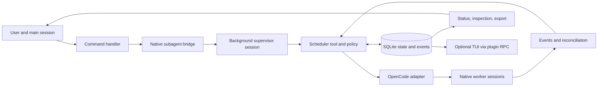

# Transparent Ultracode workflows on OpenCode 2

Status: core v1, global installation with project overrides, model-contract/lifecycle hardening, native terminal command feedback, and the visible Ultra primary agent implemented and verified on Windows/OpenCode 2.0.25 and 2.0.26. Ultra is installed globally and appears beside Build and Plan in the running OpenChamber 2.2.0 picker. Its existing plugin-options JSON editor supports settings reads and writes; the production reader/writer and graphical Plugins list/editor are checked. `/ultracode config` remains the sole terminal configuration entry point. OpenChamber discards native RPC feedback and has no Ultra slash-command result viewer; OPENCHAMBER-COMMANDS records the proposed host bridge. Dedicated settings forms, a menu, and a workflow panel are proposed in section 15. Research and implementation date: 11 October 2026. This document retains the original design decisions, records delivered behaviour, and identifies future extensions separately. See the [README](../README.md) for installation and command examples.

## 1. Recommendation

The OpenCode 2 plugin contains a persistent workflow engine. The model proposes tasks and design decisions; deterministic code validates the plan, schedules agents, enforces limits, records events, and decides whether required checks are complete.

Make the process inspectable at each layer: prompts, context inputs, plan revisions, dispatch decisions, native sessions, tool activity, outputs, changes, verification, and usage. Thoroughness comes from separating discovery, design, implementation, independent review, and verification, with bounded opportunities to correct mistakes.

Use OpenCode's existing background subagents. Add workflow management around them rather than replacing its provider integration, session runner, or permission system. This is an independent implementation of a documented behavior, with our own prompts and policy.

## 2. What the research establishes

Claude documents Ultracode as automatic dynamic workflow orchestration. A generated JavaScript program coordinates agents outside the main conversation and can be inspected and reused. Reasoning effort is a separate setting. Its private prompts and planning heuristics are not established by that documentation. [Claude workflows](https://code.claude.com/docs/en/workflows), [model configuration](https://code.claude.com/docs/en/model-config#adjust-effort-level).

The linked OpenUltraCode project supplies commands, role prompts, workflow instructions, and a plugin that records state and verification. At the inspected revision, its plugin does not implement a queue or dispatch sessions. We should retain the useful separation of roles and explicit verification, and implement scheduling as runtime behavior. [Inspected hooks](https://github.com/norandom/OpenUltraCode/blob/2638f032698c9e8e68b624194c67eb6bd84ed909/src/hooks.ts), [workflow skill](https://github.com/norandom/OpenUltraCode/blob/2638f032698c9e8e68b624194c67eb6bd84ed909/.opencode/skills/open-ultracode/SKILL.md).

OpenCode 2 is the new `@opencode/cli` / `@opencode/plugin` platform. The legacy `@opencode-ai/sdk/v2` path alone is not a compatibility target for this proposal. Initial target: installed CLI **2.0.25**. See [research notes](research.md) for source pins and API caveats.

## 3. Scope and boundaries

The first release implements:

- Support design-only work and full implementation workflows.
- Fan out independent discovery and review tasks while the main conversation stays available.
- Track dependencies, attempts, permissions, failures, interruption, and restart recovery.
- Keep every prompt and result attributable to a task and native session.
- Configure models and reasoning variants per role or workflow stage, with explicit selection provenance.
- Produce a completion report backed by fresh verification evidence.
- Support a directory without Git with serialised writes. Windows is verified; macOS and Linux remain validation targets.

Session-wide automatic mode is also implemented with explicit opt-in and a visible prompt-length rule. Later releases can add arbitrary workflow builders, optional mixed-model panels, production parallel worktree integration, and a native terminal dashboard. JSON, Markdown, a read-only HTML snapshot, and a native terminal configuration viewer are available now.

The engine does not promise identical LLM answers on replay, visibility into private model reasoning, exactly-once external side effects, or a billing-grade hard spending ceiling. It can expose the observable workflow and reuse unchanged successful outputs.

## 4. Agent mode and commands

The preferred entry point is the visible **Ultra** primary agent beside Build and Plan. It interprets ordinary conversation and uses `ultra_task` for a new authorised project task, with explicit `plan` or `execute` scope. It uses typed `ultra_control` actions for recorded status, inspection, settings, and existing-run controls. Selecting Ultra alone, asking a general question, and prompt length do not create a graph. Replies focus on technical findings, design decisions, changes and verification. Bounded startup and specific-run status content supplies the objective and intended task purposes; completion content carries accepted current results. The existing engine and role/stage model resolution remain responsible for execution. The [AGENT-MODE change](#change-agent-mode--native-primary-workflow-entry) records admission contracts, and [CODE-CONVERSATION](#change-code-conversation--technical-replies-and-result-handoff) records the revised response guidance and result handoff.

Register one `/ultracode` command with a real argument parser and deterministic control handlers. Status, cancellation, and configuration inspection must not require an LLM round trip. Unknown subcommands return usage rather than being guessed by a model.

| Command | Behavior | First release |
| --- | --- | --- |
| `/ultracode start <task>` | Reserve a run ID and show `starting`; then discover, design, implement, review, reconcile, verify, and report within the requested scope. | Yes |
| `/ultracode plan <task>` | Run discovery, design, and independent critique. Save a proposal and execution graph; stop before implementation. | Yes |
| `/ultracode run <run-id>@<revision>` | Execute a saved proposal, binding to its exact revision after checking workspace freshness. | Yes |
| `/ultracode status [run-id]` | Show stage, tasks, agents, waits, budgets, and completion coverage; list runs when omitted. | Yes |
| `/ultracode inspect <run-id> [task-id]` | Show graph, decisions, prompts, observed context, attempts, session IDs, results, snapshot hashes, and evidence. | Yes |
| `/ultracode pause <run-id>` | Stop dispatching new work; let active attempts settle, then become paused. | Yes |
| `/ultracode resume <run-id>` | Reconcile existing sessions and freshness, then continue eligible tasks. | Yes |
| `/ultracode cancel <run-id>` | Stop dispatch, interrupt active agents, and wait for acknowledged termination. Preserve partial work. | Yes |
| `/ultracode retry <run-id> <task-id>` | Make a new recorded attempt after checking that the old writer stopped and its inputs remain valid. | Yes |
| `/ultracode export <run-id>` | Export plan, event history, results, and evidence as JSON, Markdown, and a read-only HTML snapshot, with redacted fields identified. | Yes |
| `/ultracode config` | Show effective limits, role models, prompt versions, capability checks, and their origins. | Yes |
| `/ultracode input <run-id> <answer>` | Record an answer to a worker question, settle existing children, and refresh affected tasks and descendants. | Yes |
| `/ultracode budget <run-id> <limits-json>` | Increase limits explicitly for a paused or budget-blocked run, preserving counters. | Yes |
| `/ultracode on` / `/ultracode off` | Enable or disable automatic workflow selection for subsequent prompts in this session. | Yes |

Commands remain an explicit control interface. `/ultracode -- <task>` is an unambiguous alias for `start`. An unrecognised bare argument returns usage, so a misspelled control command cannot accidentally start work. IDs may be shortened only when unambiguous in the project. Mutating controls require the original initiating conversation and location; command status and inspection can read other runs in the project. The conversational tools scope reads and mutations to their own initiating session and location.

Examples:

```text
/ultracode plan Add resumable uploads to the API
/ultracode inspect run_42
/ultracode run run_42@3
/ultracode status run_42
/ultracode cancel run_42
```

Starting an implementation run authorizes its design and execution stages within the task scope. No mandatory extra approval between every stage. A design-only run stops at its proposal; `run` explicitly starts implementation. Existing OpenCode permission prompts still apply, and missing requirements can put a run into `waiting_input`.

| Control | Allowed transition |
| --- | --- |
| `run` | `ready` proposal to execution of the exact referenced revision; rejects stale inputs before writing. |
| `resume` | `paused`, `waiting_input`, or `waiting_budget` to its previously authorized mode once the blocking condition is resolved; never converts `ready` into execution. |
| `retry` | Retryable failed/blocked task after settlement; a terminal run gets an explicit recorded continuation, preserving its mode and acceptance requirements. |
| `cancel` | Active run to `cancelling`, then `cancelled` after settlement; a ready proposal can be cancelled without executing it. Terminal runs return their existing status. |

Commands outside their allowed state return an explanation without changing scope. Executing a saved plan launches a new supervisor binding for that run's continuation; it does not revive an old tool invocation.

Legacy automatic mode uses explicit session opt-in, persisted across restart. Ordinary prompts in other primary agents meeting `autoThreshold` (default 80 characters) start a workflow when no active run exists in that session. Ultra mode bypasses that rule and interprets requests with its tools. Internal notices and workflow children are excluded. Text found in a file, web response, or agent result cannot turn automatic mode on. Turning it off affects future requests; cancellation of an existing run is explicit.

## 5. Workflow and design quality

Default workflow:



For a small task, collapse roles or use one worker. For a complex design, use independent proposals or split discovery by subsystem. A planner must state why additional agents help and what each can do independently. A scheduler should reject a graph that only duplicates the same task without a stated comparison purpose.

Each design records the problem, assumptions, acceptance criteria, alternatives, recommended interfaces, error behavior, data changes, test approach, risks, and unresolved decisions. Each implementation task has dependencies, owned paths, expected output, and verification criteria. Reviewers receive requirements and the relevant snapshot; their first assessment does not need the implementer's self-assessment.

Suggested roles:

| Role | Job | Default capability |
| --- | --- | --- |
| Supervisor | Host the scheduler's long-running tool call. | Workflow control and permitted delegation; no project edits. |
| Explorer / researcher | Establish facts and constraints. | Read/search; web access when available. |
| Planner | Produce or revise a structured proposal. | Read; submit structured artifacts. |
| Implementer | Make a scoped change. | Write in its assigned checkout; approved tools. |
| Reviewer | Find concrete correctness and requirement gaps. | Read-only; no arbitrary shell access. |
| Verifier | Obtain check results and assess acceptance coverage. | Approved check execution; no project edits by default. |
| Synthesizer | Reconcile evidence and produce the user report. | Read results; no project edits. |

Fresh context is the default. Every task receives a manifest containing the objective, requirements, relevant files or snapshots, selected predecessor outputs, constraints, output schema, and its input hash. Large outputs stay in artifacts; workers receive selected excerpts and references, with any truncation visible.

### Model selection per role and stage

The global installer registers the plugin and its two dedicated agents in OpenCode's user configuration, with delegation depth of at least two. It follows the pinned host's `OPENCODE_CONFIG_DIR` override and XDG directory rules, including on Windows. It validates before mutation, preserves unrelated native settings and an original backup, and skips unchanged writes. Explicit standalone project installation remains supported.

The live plugin receives OpenCode's effective native options and merges an optional `ultracode.json` from the exact session directory before supplying built-in defaults. Model role/stage maps, prompts, and limits merge by key; scalar values and complete check arrays replace inherited values. Each layer is validated separately, so later overrides cannot conceal invalid inherited options. Omitted checks retain project script discovery; explicit `[]` disables it. Installation does not create project configuration or shared workflow state. State and capacity remain scoped to the canonical native project.

Save configuration while workflows are settled, then reload or restart the host to ensure activation. Native source watching can apply plugin-options edits; an exact-directory `ultracode.json` edit requires restart. Uninterrupted in-flight reload is not verified. New runs capture the resulting effective configuration; saved runs keep their original settings. Effective model origins retain the existing `project.role`, `project.stage`, and `project.default` labels, which now include inherited global defaults; field-level global/file provenance is not recorded. A legacy native project registration for the identical package target replaces global native options, rather than merging them. To inherit defaults, migrate its options to `ultracode.json` and retain the single global registration. Offline previews follow that replacement for selected direct global/project files, reject ambiguous target aliases, then merge `ultracode.json` and apply explicit `--config` last; full native ancestor/include discovery belongs to OpenCode.

Include configurable model selection in the first release. A role mapping can choose the planner, implementer, reviewer, verifier, explorer/researcher, or synthesizer model. A stage mapping can select a model for discovery, design, implementation, review, verification, or reporting. The supervisor can also have a role override, although most of its work is deterministic scheduling.

Plugin-options example; the model names below are placeholders for references in the user's connected OpenCode catalogue:

```json
{
  "models": {
    "default": "inherit",
    "roles": {
      "explorer": "provider/model-for-exploration",
      "planner": "provider/model-for-design",
      "implementer": "provider/model-for-coding",
      "reviewer": "other-provider/model-for-review",
      "verifier": "inherit"
    },
    "stages": {
      "reporting": "provider/model-for-reporting"
    }
  }
}
```

Accept OpenCode references of the form `provider/model` or `provider/model#variant`. Resolve model and variant together; changing the model must not retain an incompatible reasoning variant from another provider. Inheritance uses the initiating session's captured model and variant, not a model selected later in that conversation. OpenCode already supports agent models and parent-model inheritance. [Official agent model configuration](https://dev.opencode.ai/v2/docs/agents/#model).

Selection precedence:

1. Explicit task override authorized by the user/configuration.
2. Per-run stage override.
3. Per-run role override.
4. Project stage mapping.
5. Project role mapping.
6. Resolved run default, which is the captured parent model when `default` is `inherit`.

Run overrides take priority over project mappings. Within a scope, a stage mapping is more specific than a role mapping. Resolve the configured default from run options, then project options, then inheritance. A per-run default changes unspecified tasks; it does not erase more specific role/stage choices. Preserve `inherit` as an explicit selection with its origin visible.

Before dispatch, validate provider connection, model availability, requested variant, and known required capabilities. Reject unavailable or known-incompatible selections without silently falling back. Unknown capabilities are disclosed and tested rather than presented as supported. Planner-proposed selections must stay within the run's authorized model configuration.

Freeze the resolved reference and its configuration origin for each attempt. `config` and `inspect` show the effective mapping, model/variant, any degraded capabilities, and observed usage per model. Resume/retry retain the saved choice; an explicit selection change records revised inputs and invalidates affected cached results. Machine checks still run through native tools; the verifier model interprets evidence, while command results establish whether a check passed.

### Similarity to Claude

The intended behavior follows the same public pattern: task-specific planning, parallel independent agents, critique, validation, persisted results, and inspectable background progress. Our default phases are a template; a validated planner can propose a different graph and bounded revisions within the user's objective and budget.

The first release has explicit commands, opt-in automatic invocation, and a declarative graph. Claude documents automatic session workflow selection and generated JavaScript orchestration. Our automatic invocation uses a simple visible threshold; arbitrary script execution is deferred. Different models, prompts, context selection, and native lifecycle behaviour mean comparable workflow structure does not establish equal output quality or feature parity. A task graph makes scheduling and dependencies inspectable; it does not establish superiority. [Claude's documented orchestration](https://code.claude.com/docs/en/workflows).

## 6. Architecture



Use TypeScript, checked official OpenCode types, JSON Schema for contracts, and a local SQLite database. Keep the core independent of OpenCode: it receives typed adapter outcomes and emits state transitions and dispatch intents. No dependency on undocumented HTTP paths in core policy.

The scheduler runs while the OpenCode server and its plugin are active. A detached operating-system service is not necessary for the first release. Closing the UI may leave server work running; stopping the server ends active execution. Restart reconstructs state and reconciles persisted native sessions before continuing.

### The permission-preserving execution bridge

A slash command has a session ID but is not itself an agent tool invocation. Do not fabricate a tool context to launch a native subagent.

For the initial design, the command handler transactionally reserves a run ID, a project admission slot, and a start intent containing the user's exact task, mode, plan revision when relevant, scope, and initiating session. It shows `starting` and admits a request to call `ultra_start` with that intent ID. The actual invocation must consume the stored intent from the bound session; it cannot replace the user's task with model-generated arguments. That real tool invocation then invokes the registered native `subagent` executor with its actual context to start an `ultra-supervisor` in the background. The supervisor calls `ultra_execute`, which holds a real invocation context while the scheduler dispatches permitted worker agents.

The supervisor consumes a native delegation level; workers cannot delegate further. It hosts a long-running deterministic scheduler tool. The inspected native depth default is one, while root → supervisor → worker needs `experimental.subagent_depth` of at least two. Both global and standalone project installers explicitly set this value and register the two reserved agents. Treat startup as incomplete until the supervisor binds to the run and starts `ultra_execute`. The original design suggested a 60-second handshake deadline; implementation uses an expiring five-minute start intent, native settlement, and run budgets. Expired or denied starts need explicit continuation and retain history.

The [compatibility spike](compatibility-spike.md) demonstrates this bridge on Windows/OpenCode 2.0.25, including real context identity, nested/concurrent children, native permission checks, and serialized tool results. It remains a version-sensitive integration rather than a dedicated public invocation API. Calling a registered executor skips normal nested tool-call admission and hooks: validate native input, declare output schemas, and record nested calls under the outer invocation. Fail closed on incompatible host contracts; never silently switch to unrestricted API-created sessions.

There is a source-verified, version-sensitive prelaunch interception: the pinned native handler creates the child, awaits `context.progress` with its ID, and only then submits its prompt. Wrap only that callback while retaining the real invocation's identity and signal. In the callback, bind the child to the persisted dispatch, install its compiled permission restrictions, and verify the resulting session before returning. Failure blocks the first prompt and leaves a recorded child for cleanup. This must also apply to supervisor creation. [Pinned ordering](https://github.com/anomalyco/opencode/blob/b44eea9e204024db2b480a136ece29d790d5f593/packages/core/src/tool/plugin/subagent.ts).

This callback is not a documented prelaunch hook. Startup must fail if the required ordering/capability check is absent. The compatibility spike must prove that denied setup never starts a model, concurrent callbacks bind the right tasks, and inherited permissions are narrowed before execution. A public upstream prelaunch API would be preferable long term.

Implemented model-facing tools are smaller than the user command surface:

| Tool | Caller | Purpose |
| --- | --- | --- |
| `ultra_start` | Initiating session | Consume a bound start intent and launch with the native bridge. |
| `ultra_execute` | Bound supervisor | Run scheduling/reconciliation for the recorded run and ownership epoch. |
| `ultra_submit` | Bound worker | Submit schema-checked task output; remains a candidate until the attempt settles. |
| `ultra_check` | Bound active verifier | Execute one configured check through the native shell and capture attributable evidence. |

Status is exposed through deterministic commands and plugin RPC rather than a worker tool.

Permissions and caller identity come from the actual session/tool context and stored bindings, never from a model-supplied `sessionId`. Workers cannot mark the entire run complete, change budgets, execute a plan-mode proposal, or impersonate another worker.

### OpenCode adapter

The core adapter contract is our own interface, not a claim about SDK method names. The initial outline below explains responsibilities; exact current types are in `src/types.ts`, with native checks and context capture implemented by `src/opencode.ts`:

```ts
interface HostAdapter {
  capabilities(): Promise<HostCapabilities>
  launchWorker(task: BoundTask, invocation: TrustedInvocation): Promise<WorkerHandle>
  inspectWorker(handle: WorkerHandle): Promise<WorkerSnapshot>
  interruptWorker(handle: WorkerHandle): Promise<void>
  observe(signal: AbortSignal): AsyncIterable<HostEvent>
  runCheck(check: CheckSpec, invocation: TrustedInvocation): Promise<CheckEvidence>
  publishReport(parentSessionId: string, report: Report): Promise<void>
}
```

The adapter binds native session, job, execution, inbox, message, and tool IDs when available. Its returned handle represents launched work, not a finished result. Preserve native failures and missing information rather than guessing status.

## 7. Asynchronous agent management

### Identities and state

Separate these concepts:

- `runId`: one user request and its workflow history.
- `planRevision`: an immutable version of the task graph.
- `taskId`: a stable logical step.
- `attemptId`: one execution or retry of that step.
- `agentRole`: the prompt/capability profile used.
- `sessionId`, `jobId`, `executionId`: host identities, when exposed.
- `ownerEpoch`: a fencing generation for scheduler ownership.

Run states: `starting`, `planning`, `ready`, `running`, `pausing`, `paused`, `waiting_input`, `waiting_budget`, `recovering`, `cancelling`, `succeeded`, `partial`, `failed`, `cancelled`.

Task states: `pending`, `running`, `waiting_permission`, `cancelling`, `succeeded`, `failed`, `cancelled`, `blocked`, `skipped`. Attempts additionally distinguish durable `reserved` and uncertain `ambiguous` admission. Dependency readiness is derived rather than a stored task state. Provider waiting remains native activity rather than a distinct plugin state. A retry creates an attempt rather than erasing the failure.

`partial` is terminal for a run that delivered useful work but left required criteria unresolved. Continuing a terminal run requires an explicit eligible `retry`, creating a recorded continuation. `ready` is a settled proposal state, not successful completion of implementation, and only `run` authorizes its execution.

### Scheduling

1. Validate a graph for missing dependencies, cycles, path ownership, permissions, output contracts, and budgets before dispatch.
2. Select dependency-satisfied tasks in stable order; dependencies normally require successful outputs. A task that accepts failure outcomes must declare that explicitly.
3. Acquire a task claim, an execution slot, and any checkout write lock transactionally. Persist a dispatch intent and our stable attempt ID before calling the host. Native subagent input does not accept our chosen prompt ID; capture its actual admission/message identity through the bound child's prompt hook and reconcile it separately.
4. Launch through the native bridge, record the host handle, and return control without waiting for all workers.
5. Consume host events as hints; read native state and execution records to confirm changes. Capture submitted results, tool provenance, and usage.
6. Validate settled outputs and publish a durable completion event. Unblock dependents or request a bounded plan revision.

The default project budget is **four active worker sessions**, shared across runs, and **two active runs/supervisors per project**. Admission beyond that returns a capacity result before launching another supervisor. The root conversation is outside this budget; allow at most one active supervisor per run and one implementation run per checkout. Any planner, reviewer, verifier, or synthesizer using a worker session consumes a worker slot. Report all native sessions, including supervisor overhead and possibly orphaned sessions that still reserve capacity.

A permission wait releases neither the live worker slot nor its write lock: the worker may resume. Other independent work may continue within the remaining budget. Provider backoff behaves similarly. Do not double-count host retries as fresh agents or layer an uncontrolled retry loop over the host's own retry policy.

### Completion

Prompt admission, an idle session, a `running` background response, and `ultra_submit` are not proof of success. The adapter must identify the execution associated with the admitted request, confirm a settled native outcome, and validate the output and any required artifacts. If the pinned host cannot expose a reliable terminal boundary, that is a compatibility blocker for autonomous execution.

Late or duplicate events are deduplicated by host identity and attempt. Cancelled attempts may retain artifacts, but their late results cannot unblock dependent tasks or replace the result of a newer attempt.

### Notification and messages

Persist our completion messages in an outbox with unique IDs. Native notifications and our event handling must not produce duplicate parent reports. The parent receives milestones, required input, blocking failures, and final results; full transcripts remain inspectable. Deliver Ultra-owned reports with queued semantics.

The native background completion path uses default `steer` delivery, including supervisor completion to the initiating session. The spike confirms that this does not abort an active tool; it admits the notification at the next step boundary. It can still change the next model step before an execution becomes idle. Disclose that behavior in the first slice; strictly idle-only completion requires configurable native delivery or a supported alternative bridge. Do not claim our queued outbox changes native notifications.

Exact-once notification delivery requires host-supported idempotent admission. Where only at-least-once delivery is available, retain a delivery ID and deduplicate display; make this capability visible.

Peer critique is represented by explicit dependent tasks. Their inputs reference immutable predecessor outputs. The first release does not need an unstructured peer chat bus. Later targeted steering would be a recorded inbox operation that invalidates affected inputs.

### Pause, cancel, and retry

Pause stops new dispatch; already-running attempts may finish and persist results. The run is `pausing` until active work settles, then `paused`. A worker waiting for permission can keep it in `pausing`; cancellation interrupts it.

Cancel is a different operation: mark cancellation first, interrupt bound sessions, wait for terminal acknowledgement, then release locks. A non-acknowledging worker keeps a write lock quarantined. Do not call the run fully cancelled, launch a replacement writer, or discard its worktree while it may still write.

Cancellation can race with native child creation before the dispatch binding is recorded. The adapter distinguishes no child creation, a created child whose prelaunch callback was never released and whose execution quiescence is confirmed, and uncertain cleanup. It records the created child's identity in all attested cases. A never-prompted child can have no native outcome or idle timestamp; successful native `session.wait` establishes quiescence without fabricating either. Uncertain cleanup preserves `cancelling` and capacity quarantine. It cannot change cancellation into `waiting_input` merely because launch returned an error.

Retry requires the old attempt and affected descendant workers to have stopped. It verifies native settlement and input freshness, resets the dependency closure, and clears accepted descendant pointers while preserving historical attempts and artifacts. Unrelated settled siblings retain their results. Writer retry continues only from its recorded candidate fingerprint. It cannot reuse review/check results dependent on the retried task. Do not automatically retry publishing, migration deployment, or other external side effects.

### Recovery

On plugin/server restart:

1. Acquire project ownership and increment its fencing epoch.
2. Mark interrupted runs `recovering`; inspect every recorded or partially bound dispatch.
3. Attach to still-running native sessions where possible. Reconstruct completed outputs from native records and our artifact store.
4. Treat an unknown dispatch outcome as ambiguous. Search the recorded parent/session lineage and prompt identity before creating anything new.
5. Keep potentially active writer locks quarantined until termination is established. A database lease alone cannot stop an old agent.
6. Resume only when the required host capabilities, authorization scope, workspace baseline, and budgets remain valid.

Recover state without automatically reproducing an external side effect. If the server lost the evidence needed to distinguish completion from interruption, report it as unresolved.

OpenCode 2.0.25 and later source differ in native job lifetime across plugin reload. Recovery across reload is an explicit compatibility test, not an assumed feature.

## 8. Persistence and replay

Implemented local layout in the canonical project directory:

```text
.ultracode/
  state.sqlite
  artifacts/
    artifacts/<content-hash>.json
    runs/<run-id>/
      export.json
      report.md
      dashboard.html
```

Treat runtime data as private local metadata and exclude it from version control. The exported proposal can be copied into normal project documentation. The plugin does not initialize a Git repository or modify global OpenCode configuration simply to run.

SQLite stores runs, plan revisions, tasks, attempts, events, artifacts, findings, checks, limits, claims, and the notification outbox. Transition state and append its event in the same transaction. Event ordering is monotonic per run. Artifacts are written atomically before their digest is committed; recovery can collect unreferenced temporary files.

The tested CLI does not persist historical payloads for `session.log`. Recovery must reconcile current native session/tool/permission snapshots with our database; do not assume a live event subscription or the external log endpoint can fill disconnect gaps. Record gaps explicitly. An embedded server with event persistence enabled is a separate compatibility profile, not a prerequisite silently added to normal CLI use.

Use one logical scheduler owner per canonical project. Multiple locations in one host process share a coordinator keyed by canonical state database path, project leases, worker capacity, and the writer reservation. Events and recovery are location-scoped. Independent processes are fenced and queue their genuine invocations, but this is not a distributed scheduler: recovery can limit throughput until the other owner releases its lease. Manage concurrent project runs in one OpenCode server. A database lease alone cannot establish that a native writer has stopped.

Do not rely on ordinary plugin key/value storage for multi-record transactions or compare-and-swap: those guarantees are not part of the inspected public contract. The SQLite driver/runtime combination must pass the compatibility spike on all target platforms before this choice is treated as supported.

A cache key includes the task specification, predecessor result hashes, prompt version, role permissions, model/variant, relevant workspace snapshot, and check environment. Record graph revision as provenance, without invalidating unaffected tasks solely because another graph branch changed. A resume reuses a successful result only when its own inputs remain valid. Do not rerun a successful writer as if it were a pure function; require its recorded resulting snapshot to still be present.

Plan changes create a new immutable revision, retain the reason, validate scope and budgets, and invalidate affected descendants. The scheduler never edits the historical plan in place. Bounded repair loops are expanded into recorded attempts and graph revisions rather than hidden indefinite recursion.

User requirements and required acceptance criterion IDs are immutable across repair revisions unless the user amends them. Generated refinements are versioned separately; a planner cannot remove a required check, demote a blocking requirement, or redefine success simply to make a failed run pass.

## 9. Editing isolation

First release default: one writer in the active checkout, with parallel read-only discovery and review against stable snapshots. Reads used for an acceptance gate must reference the exact candidate being reviewed, not files changing underneath the reviewer.

Record a manifest of workspace path/content hashes, including relevant untracked files. Runtime directories, build output, and dependencies are excluded; symlinks are fingerprinted without following their targets. When the writer settles, freeze a candidate digest and run review/checks against it without admitting another writer. Compare fingerprints before dispatch and again before accepting results. The main session, editor, or other processes can still edit files; detecting edits invalidates affected results and requires reconciliation. Never restore a baseline over unrelated user changes. Content digests are the freshness authority. The current trace records hashes and changed paths, not a complete version-control diff or retained copies of every source file.

Future parallel implementation would use a separate OpenCode-managed Git worktree per writer. Each would start from the same recorded baseline, including authorised uncommitted work via an explicit snapshot process. Plain `git worktree add` does not include uncommitted changes. The primitive is spike-tested; production integration is not enabled, and `parallelWrites: true` is rejected.

Workers return changes and evidence; one integrator applies them in dependency order and runs integration checks. Conflicts become explicit integration tasks. File ownership is a coordination rule, not a filesystem sandbox; native permissions and checkout isolation must enforce the capability boundary.

Never grant a worker write access to the original checkout just because its worktree is located elsewhere. Child-session location and permissions are configured before its first prompt. For worktree mode, the prelaunch callback first installs restrictions, then moves the unprompted child, waits for the move to settle, and verifies its location. A move can emit its own execution events: track those as preparation, then bind task completion to the actual task prompt admission. Destination plugin setup and this ordering must pass separate host tests. Worktree startup commands and plugins must also be reviewed as part of the inherited host execution policy.

If Git or worktree support is absent, serialize writers and state the resulting concurrency. Keep dirty worktrees after cancellation or failure. Cleanup only known owned directories after workers have stopped and useful changes have been preserved.

## 10. Permissions and verification evidence

Each task gets the intersection of user/project restrictions, the run's allowed scope, its role, and its checkout. Host permission lists may use last-match-wins rules; appending a broad allow is not an intersection. Persist the compiled effective policy and establish it before launch.

Keep an immutable run authorization policy derived from the initiating session, including its effective primary-agent and session restrictions. A supervisor's own temporary no-edit role must not accidentally become the authorization policy for an implementer: derive each child's policy independently from the run policy, then add that child's restrictions. Replacing inherited supervisor rules is allowed only with this verified derivation; user/project denies must survive. Tightened user/project permissions invalidate dispatch eligibility and require re-evaluation of active tasks.

Separate supervisor tool visibility from delegated worker authority. Its model sees only the scheduler/control tools it needs. Protect runtime metadata through task restrictions, and disclose that permissions/worktrees without an operating-system sandbox cannot make arbitrary allowed shell commands safe against all filesystem mutations.

Keep denied actions denied. Surface native permission requests through OpenCode, associate them with the attempt, and wait; agents and scripts cannot approve themselves. Worker prompts, peer findings, and repository content are data, not new user authorization. Stop nested delegation at the worker level and count every launched session.

Native API-created sessions are not an interchangeable shortcut for the `subagent` tool: they can omit its delegation checks. Session permission overrides can also replace inherited rules. These are integration hazards to prove with real-host tests.

Checks should execute through a permission-checked native tool in a real invocation context, or through a verifier's ordinary native tool calls. The plugin must not use an unrestricted process runner to evade shell permissions.

Capture evidence from the actual tool/execution record:

```ts
type CheckEvidence = {
  evidenceId: string
  runId: string
  taskId: string
  attemptId: string
  criterionIds: string[]
  sessionId: string
  toolCallId: string
  command: string
  cwd: string
  startedAt: string
  finishedAt: string
  exitCode: number | null
  outcome: "passed" | "failed" | "blocked" | "cancelled" | "unknown"
  outputArtifact: string
  workspaceDigest: string
  environmentDigest: string
}
```

An exit code of zero establishes that a command passed, not that an arbitrary product requirement is satisfied. Map checks to acceptance criteria explicitly. Model judgments are separate assessment records and never manufacture machine evidence. Record skipped checks, partial output, and unverified claims in the final coverage report.

Run success requires successful required tasks, fresh relevant evidence for required criteria, and disposition of blocking findings. Findings may be fixed and reverified, rejected with evidence, or explicitly deferred within authorized scope. Accepted findings still awaiting a fix are unresolved. If required checks are unavailable or limits are reached, report `partial` or `failed` with the reason.

## 11. Transparency and budgets

`inspect` must answer: What did it do? Why did it spawn this agent? What did the agent see? Which model ran? What changed? What actually passed? What is still missing?

Record prompt/template versions and rendered task prompts, context manifests and excerpts, selected models and variants, delegation decisions, admission and permission outcomes, tool inputs and output references, retries, plan diffs, changes, checks, token usage, and reported cost. Include auxiliary supervisor and reporting usage when observable.

Capture plugin-added instruction changes at supported host hooks and disclose other hooks or providers that prevent complete capture. A reconstructed prompt is labelled as reconstructed; do not claim it is the exact provider request. Do not log credential headers. Redactions remain visible with field names and reasons, and redacted exports are labelled unsuitable for complete replay.

Implemented defaults, configurable and visible through `config`:

| Limit | Default |
| --- | --- |
| Active worker sessions per project | 4 |
| Active runs / supervisors per project | 2 |
| Active supervisor sessions per run | 1 |
| Total worker attempts per run, including planner/review/repair | 24 |
| Model steps per worker | 24, if host enforcement is available |
| Repair rounds | 2 |
| Time since worker admission, including permission wait | 10 minutes |
| Active execution time per run | 45 minutes |
| Elapsed time per run | 24 hours |

The original design proposed excluding permission wait from active deadlines. The current implementation counts native permission wait and provider backoff towards worker/run deadlines. A fully settled pause stops the run's active clock; elapsed time continues. Reaching a limit stops dispatch and interrupts active workers, retaining reservations until settlement. `budget` accepts explicit increases and preserves consumed counters; `resume` then reconciles eligible continuation.

Token/cost admission budgets are a future extension; v1 records observable usage but does not enforce a spending ceiling. Such budgets would need recorded usage plus reserved in-flight allowances and would still have overshoot from streaming requests and unknown pricing. Missing usage remains unknown. Current controls are agent counts, concurrency, rounds, deadlines, and model steps.

## 12. Choices and tradeoffs

| Decision | Reason | Cost / revisit condition |
| --- | --- | --- |
| Declarative task graph first | Schema validation, explicit dependencies, durable replay, and no arbitrary generated code execution. | Less expressive than Claude's JavaScript workflows; add a builder when concrete use cases need it. |
| Adaptive graph revisions | Preserve model-driven planning without hiding runtime control. | Revalidation and invalidation are necessary after every change. |
| Native OpenCode execution | Reuse provider integration, permission checks, sessions, and background agents. | Pin host contracts and test lifecycle differences. |
| Scheduler hosted by background tool | Keep a genuine tool context and a responsive parent session. | Additional supervisor session and a bridge compatibility gate. |
| SQLite and event history | Transactional state, safe multiple clients, and inspectable recovery. | Driver packaging must work in the host plugin runtime. |
| One writer by default | Simple integration and protection of uncommitted user work. | Parallel implementations require snapshot and worktree support. |
| Parent's chosen model by default, role/stage overrides in the first release | Predictable defaults and deliberate model selection for different work. | Validate connected models/variants and include every override in provenance. |

Public prompt files should be short and role-specific. Publish scheduling and completion policy as normal source code and versioned schemas. Changing a prompt is a reviewable configuration change, not an unexplained runtime feature.

## 13. Implementation milestones and validation

### A. Compatibility spike before the engine

Use an isolated temporary project against installed OpenCode 2.0.25, without altering the user's global settings. Pin the matching official packages/source and publish the matrix of capabilities demonstrated.

Prove command execution; real custom-tool context; native subagent dispatch; supervisor-to-worker depth; asynchronous return; reliable terminal detection; read-only permissions; permission waits; native check provenance; cancellation acknowledgement; duplicate event handling; notification admission; plugin reload and server restart; project/worktree event filtering; and SQLite persistence.

If the execution bridge cannot preserve native permission and lifecycle semantics, revise it or propose a small upstream public invocation API. Do not ship an unrestricted shortcut. Declare unsupported lifecycle behavior explicitly rather than claiming blanket OpenCode 2 compatibility.

### B. Read-only vertical slice — implemented

Implement `plan`, `status`, `inspect`, `pause`, `resume`, `cancel`, `config`, and `export`, including role/stage model resolution. Run two independent discovery workers, a planner, and a critic. Persist the proposal and all task history. Demonstrate restart without duplicate workers or lost results, and verify configured model/variant selection and rejection of unavailable choices.

### C. Full execution with one writer — implemented

Add `start`, executing saved proposals, implementation, review, permission-checked verification, bounded repair, and evidence-backed reports. Demonstrate that failed checks and stale evidence cannot produce success.

### D. Isolated parallel writing and native TUI — future extension

Add baseline snapshots, worktrees, serialised integration, and a native terminal dashboard. Commands, exports, and the current read-only HTML snapshot already support inspection.

### E. Automatic mode and reusable workflows — partly implemented

Explicit session `on/off`, a visible routing threshold, custom role prompts, versioned default templates, and planner-proposed validated graphs are implemented. A template library, dedicated mixed-model comparison panels, and a restricted workflow builder remain future extensions.

Required runtime tests target behavior, especially the failure boundaries: cycle rejection, task claim races, multiple runs, ambiguous launch recovery, cancellation versus completion, queued permission waits, writer quarantine, stale result invalidation, plan-only capability limits, inherited permission preservation, dirty-tree integration, and final evidence coverage.

Use fake adapters for scheduler/state-machine tests and real OpenCode integration tests for permission, execution, reload, and cancellation semantics. Asset-presence tests alone do not demonstrate orchestration support.

## 14. Implementation checkpoint and remaining validation

On 11 October 2026, the compatibility spike was followed by the core v1 runtime, project installer, offline inspection CLI, and exports. The earlier “no runtime” proposal and “begin the vertical slice” checkpoint are superseded by this implementation record; the design decisions and optional milestones above retain their original scope.

Initial runtime checkpoint against installed OpenCode 2.0.25 on Windows, before the final installer and retry audit:

- **115 unit and regression tests pass**, including scheduler admission, SQLite races and fencing, genuine invocation ownership, native settlement, writer quarantine, model precedence, stale evidence, bounded repairs, permission ordering, metadata junction rejection, and cancellation. Behavioural regressions used failing tests before fixes where appropriate.
- **12 production native integration checks pass**: registration, invalid-command rejection without model calls, plan-only work and model routing, exact saved-plan execution, role restrictions and native check provenance, exports, restart persistence, expired intents, cancellation, automatic mode persistence and invocation, opt-out, and unavailable-model rejection without fallback.
- Strict TypeScript checking passes. Integration used 73 local fixture model requests and no paid providers; it demonstrates execution contracts, not real-model design quality.
- This checkpoint's native evidence is `.spike/integration-1791733826576-91593eeb/integration.json`, with plugin snapshot SHA256 `3517a17fd3692dcc2e43949db8dd84e170fee35c031116cb0c8cfa41597774d1`. Evidence records the source snapshot rather than relying on an unavailable Git commit.
- The prior compatibility spike retains its separate [22-probe result record](compatibility-spike.md), including the unsupported native event-payload replay profile and tested worktree primitives.

Final audit checkpoint, also 11 October 2026: **124 unit and regression tests pass**, with **570 assertions**, and strict TypeScript checking passes. Failing regressions preceded fixes for omitted check configuration, shared offline worktree state selection, retry dependency invalidation, and dangling permission-scope junctions. Model-only installation retains automatic check discovery; explicit `checks: []` remains an opt-out. Retrying a failed task refreshes dependent review/check work while retaining history. Offline `--state` selects the shared native project database without creating a worktree-local database or dispatching agents. Unresolved links cannot gain an in-project write allow.

The subsequent native rerun exposed a cancellation race at the reservation/prelaunch boundary. The failing evidence is retained in `.spike/integration-1791734541384-ca3de479/integration.json`; a deterministic held-prelaunch fixture also reproduced it in `.spike/integration-1791734945061-3a042a9b/integration.json`. Typed launch outcomes and cancellation-preserving transitions fixed it, with failing regressions preceding the adapter and engine changes.

**Final completion checkpoint: 131 tests pass, 610 assertions, zero failures; strict TypeScript passes; all 12 production native integration checks pass.** Evidence: `.spike/integration-1791735074838-acd6736b/integration.json`, production plugin snapshot SHA256 `ca1664a5b421a409590cf557ffffaa62a7e31deba94fc142afb33ed34111b807`. The final integration used 72 loopback fixture requests. Its recorded test wrapper holds one native child after creation and before production binding, making cancellation reproducible without editing production source. The streamed worker was interrupted; the unused reserved child was never prompted, had zero messages, model requests, and pending prompts, and its native wait returned. Its identity and quiescence proof are retained in durable events. Both attempts settled as cancelled with their distinct evidence preserved.

The exact host version gate remains in place because the bridge relies on source-verified prelaunch ordering. Future host versions and macOS/Linux need the same native tests before support is claimed. In-flight plugin reload, mixed-process recovery throughput, real provider behaviour, and production parallel worktree integration need additional validation beyond settled-run restart. No equality or superiority claim against Claude follows from these tests.

The shared documentation catalogue was consulted for this checkpoint. It contains no matching Ultra Open Code project, so this existing local design remains the documentation home; no unrelated central project record was created.

### Change GLOBAL-INSTALL — global installation and optional project overrides

Decision: **accepted**. Implementation: **implemented**. Verification: **passed on Windows/OpenCode 2.0.25**. This follow-up extends the core v1 delivery at code commit `c324a4ce396100d6ed134b1441681ad2bd6f299c`; the earlier completion checkpoints retain their original scope.

Delivered on 11 October 2026: `install:global` and default global installer mode, explicit standalone project mode, pinned native config-directory discovery, non-mutating validation and idempotent configuration writes, and optional exact-directory `ultracode.json` overrides. Global defaults remain unchanged across projects. Named model maps, prompts, and limits inherit by field; complete check arrays replace. The offline CLI follows native same-target registration replacement, rejects ambiguous aliases, then applies project and explicit preview overrides. Native provider credentials and unrelated settings remain in their original configuration without being included in installer output.

TDD recorded failing installer, config-layer, CLI, and host-bootstrap tests before implementation. Further failing regressions preceded fixes for named and Windows-relative package entries, duplicate registrations hiding requested options, malformed configuration source exposure, and native registration replacement. The initial native run exposed fixture projects inheriting this checkout's newly created Git root; retained failure evidence is `.spike/integration-1791736631123-71dd3517/integration.json`. Independent fixture repositories now establish two different native project identities without modifying the source repository.

Final checks: **166 tests pass, 760 assertions, zero failures; strict TypeScript passes; 13 production native integration checks pass**. Native evidence: `.spike/integration-1791736690304-c40e69b1/integration.json`, production plugin snapshot SHA256 `3bdd5044baf9b336d01b86d41b1ec335ce40eec110085e4a6ca96c14f4fd3168`, with 91 loopback fixture requests and no paid model calls. The production `src` tree matches the tested snapshot. Native checks used the actual global installer and demonstrated availability in two projects, inherited and overridden models/prompts/limits, explicit empty checks, actual planning, distinct SQLite state, and all prior execution, cancellation, restart, opt-in, and no-fallback behaviour. Installer command smoke checks verified manifest-based host detection and unchanged second installation in an isolated directory.

This task implements the installation feature and pushes its source; tests use isolated configuration rather than applying global settings to the user's current OpenCode profile. macOS/Linux, newer host versions, native ancestor/include discovery in offline previews, and field-level source provenance remain outside these checks.

## 15. Plugin, model contract, and native UX review

The 11 October 2026 review checked the installed 2.0.25 plugin types, host source, native plugin-manager help, and versioned documentation. The server plugin uses public registration, permission, session, event, and RPC APIs. Its native execution bridge remains a source-sensitive boundary: calling the exposed native tool executor retains the handler's permission checks, but does not pass through the normal outer tool admission and before/after hooks. Child binding also depends on the native subagent awaiting its progress callback before prompting. Keep the exact host gate and production compatibility tests until a supported invocation and prelaunch API can replace that boundary. This review does not establish complete interoperability with other plugins.

The current command and export interface is usable, but a native terminal client should become the main interactive interface. Public terminal extension points support a command palette, custom dialogs, plugin routes, and session panels. The inspected API has no settings contribution interface or settings slot. OpenCode's built-in **Open settings** action edits its CLI configuration, which is separate from server plugin options; unknown CLI settings are rejected. A plugin-owned **Ultra settings** dialog is therefore the supported terminal proposal. OpenChamber independently provides the existing native plugin-options editor checked in [CLIENT-SETTINGS](#change-client-settings--single-command-and-openchamber-configuration); dedicated form controls there require a client change. See the [API review](research.md#plugin-and-terminal-api-review--11-october-2026).

### Change MODEL-CONTRACT — explicit structural results and bounded repair

Decision: **accepted**. Implementation: **implemented**. Verification: **passed on Windows/OpenCode 2.0.25**. The model-visible `ultra_submit` contract describes nested results and proposals through the same structural schema used to validate submissions in the engine. Task prompts list actual criterion IDs, explain when assessments are required, and include a small valid submission example. Invalid arrays, finding evidence, and artifact references fail before persistence with an actionable field error.

Structural validity and workflow policy remain distinct. The engine must still validate graph dependencies, authorised models, required criteria, checks, evidence freshness, and session ownership. A structurally valid proposal does not authorise arbitrary actions. Repair must preserve the union of accepted writer scopes; a graph without an accepted writer must not acquire a fabricated writer during repair.

This contract gives tool-capable models explicit instructions without provider-name branches or exact prose matching. Roles, model/variant mappings, prompt additions, and planner-generated task graphs remain configurable. The default graph is a transparent fallback. State transitions, permission boundaries, limits, and evidence rules remain deterministic code. Scripted-provider integration tests establish API behaviour; they do not establish model quality, Claude parity, or equal reliability across models.

### Change PLUGIN-HARDENING — packaging and lifecycle

Decision: **accepted**. Implementation: **implemented**. Verification: **passed on Windows/OpenCode 2.0.25**. The pinned host-compatible Effect runtime is declared as both a peer and development dependency, as required by the installed SDK. Configuration is validated before creating project state. Failed setup cleans up every acquired registration and the database; teardown is idempotent even when one disposer fails. Shutdown refuses bound workflow operations and new automatic dispatch while preserving ordinary unbound permission, context, model, and prompt requests. Missing-agent guidance uses the global installer, and configuration reports the actual prompt version.

### Change NATIVE-UX — menu, settings, and live workflow inspection

Decision: **proposed**. Implementation: **not started for the editable settings UI, workflow menu, and live panel**. Verification: **API feasibility reviewed; those product behaviours not checked**. The subsequent COMMAND-FEEDBACK fix supplies a `./tui` companion and read-only configuration viewer. OpenCode loads that companion with the configured server plugin, without a second plugin entry in `cli.json`. Keep all existing `/ultracode` commands and offline exports available. The terminal client calls server RPC rather than scheduling workers or writing configuration itself.

The entry point is a command-palette item **Ultra: Open menu**, with `/ultra` as a discoverable shortcut if it can coexist with the current command registration. Its actions are:

| Action | Native interaction and outcome |
| --- | --- |
| Plan a task | Prompt for an objective; show the read-only workflow and its saved proposal. |
| Start a task | Prompt for an objective and show the selected defaults; start within the requested scope. |
| Active workflows | Select a run, open its live task panel, inspect results, and open its actual native sessions. |
| Settings | Edit Global defaults or This project with inherited values and field origins visible. |
| Diagnostics | Show installation, host version, reserved agents, delegation depth, model availability, configuration sources, and observer health without model calls. |

The settings dialog should provide model and variant pickers from the native catalogue, role/stage overrides, concurrency and deadline controls, bounded repair limits, check discovery or explicit check commands, and optional role prompt additions. Each project field should offer **Use global default** by removing that local override. Check lists replace as a whole; show **Discover project checks**, **Use inherited checks**, and **Explicit checks**, including an explicit empty list. Show effective values before saving and return validation errors beside the affected fields.

The workflow panel should show phase, task status, selected model, dependency or permission waits, unresolved findings, and native check evidence. Controls are Pause, Continue, Cancel, Inspect, and Open agent session. A saved design offers **Execute this revision**, binding to the displayed revision and workspace digest so the user need not type an ID/revision pair. A stale workspace requires an explicit refresh action. Progress comes from durable snapshots plus live RPC events; reconnect always reloads a snapshot because live RPC events are not persisted.

Settings writes belong in the server. Add a validated, user-owned settings RPC with a fixed global/project target, source revision checking, backup, and atomic replacement. Reject worker sessions and stale edits. Preserve unrelated native provider and permission configuration. Remote clients must edit the server's project configuration, not an unrelated local file. Do not use terminal-local storage for execution settings. New runs capture the saved configuration; running workflows keep their existing snapshot. If applying a change needs restart, show that accurately and avoid forcing plugin reload during active work.

OpenCode's native plugin manager supports npm and Git package sources. Versioned installation through that manager is desirable, followed by an explicit setup/diagnostics step for the reserved native agents and delegation depth. The public agent editor can update existing agents but has no supported add operation in the inspected version. Do not promise that `opencode plugin add` alone replaces all current installer duties. Retain the local-checkout installer for development and publish a versioned package only in a separately authorised release task.

### Change CONTEXT-POLICY — model-neutral context and early admission

Decision: **proposed for aggregate budgeting and retrieval; accepted for concise handoffs**. Implementation: **summary projection and dependency deduplication implemented; aggregate budgeting and retrieval not started**. The versioned renderer, currently `ultra/4`, limits narrative summaries to 6,000 characters and retains complete structured findings, assessments, proposals, questions, and artifacts. Accepted design results already present as direct dependencies appear once. Original results remain immutable in state, and the prompt records narrative truncation. The earlier 24,000-character JSON-prefix limit could discard later structured evidence and cut JSON mid-value; it has been removed. Regression tests cover long summaries, valid JSON, retained evidence, and deduplication. `ultra/4` also adds technical-summary guidance as recorded in CODE-CONVERSATION.

There is still no aggregate budget or bound retrieval tool. Retain model context/input/output limits in the adapter, budget the whole task prompt conservatively, and supply concise predecessor summaries plus a read-only retrieval tool restricted to accepted dependencies. Record what was omitted and retrieved. Do not choose behaviour by provider name or silently discard required criteria.

Validate an execution proposal's review and configured-check coverage at admission. Report missing dependencies or checks immediately so the planner can correct the graph, rather than relying on a late partial result or repair to discover an incomplete workflow. Make workflow templates and discovery breadth optional strategy settings; preserve immutable criteria and enforce the existing permission and evidence policy for every strategy.

Evaluate model behaviour separately from runtime integration. An opt-in suite should cover schema correction, design critique, file scope, finding reconciliation, and honest blocked/partial outcomes across user-selected models. Record model, variant, fixture, request count, and outcome. Paid-provider evaluation requires an explicit model selection and budget; the existing local scripted suite cannot substitute for it.

### Change GLOBAL-LIFECYCLE — passive global loading and observable recovery

Decision: **proposed**. Implementation: **not started**. Verification: **reviewed only**. Defer project state creation until the first workflow or automatic-mode activation. Help, configuration, diagnostics, and terminal menus should work without creating `.ultracode` or requiring a writable project. Existing-state inspection should open state when present. This makes a globally loaded plugin unobtrusive in ordinary OpenCode sessions.

Expose event-observer health through diagnostics and RPC. Add bounded reconnect with reconciliation against current native session snapshots, and record every observation gap. A failed observer must not quietly stop tracking forever; reconnection must not pretend to recover native event history that the host does not retain. Validate setup failure, in-flight disposal, observer interruption, reconnect, and permission isolation in native fixtures before expanding compatibility.

### Validation plan for the proposed terminal client

Use behavioural tests for settings inheritance/reset, stale concurrent edits, server target selection, reserved-agent diagnostics, saved revision execution, permission-bound controls, and reconnect snapshots. Use the pinned native terminal client to check keyboard navigation, model/variant selection, narrow terminals, error focus, and remote-server settings. Verify that menu/configuration actions make no model calls, ordinary global loading creates no project metadata, and editing settings does not change an active run. Keep desktop settings support outside the claim unless a documented extension contract and a native test establish it.

### Review delivery checkpoint

The MODEL-CONTRACT and PLUGIN-HARDENING changes were delivered locally on 11 October 2026. Failing regressions preceded fixes for malformed nested evidence, repair scope expansion, repair without an admitted writer, absent structural/example guidance, state creation before config validation, setup and disposal failures, unrelated permission/request disruption during shutdown, and an outdated reported prompt version. Missing-input submissions remain valid without fabricated assessments. The schema parser rejects unknown fields and duplicate claim IDs without echoing rejected input values.

**180 tests pass, 866 assertions, zero failures; strict TypeScript passes; all 13 production native integration checks pass.** The unchanged integration fixture accepted the new schema and `ultra/2` prompts. Evidence: `.spike/integration-1791739283124-276822be/integration.json`, production plugin snapshot SHA256 `0e52a4d4206c037445a634d8e90aa56a7ea36316d6703ad04620803136be5c5e`, with 91 loopback fixture requests and no paid model calls. The production source matches the tested snapshot. Frozen-lockfile installation passes without dependency changes. Changed documentation links and anchors pass the Vault checker; the central catalogue was also checked without adding an unrelated Ultra record.

Native UI, context budgeting, early graph coverage, passive global loading, observer reconnect, real-model evaluation, newer host versions, and other operating systems remain outside these checks. These hardening changes and the native UX proposal have not been pushed to GitHub in this review task.

### Change COMMAND-FEEDBACK — visible terminal results and configuration

Decision: **accepted**. Implementation: **implemented**. Verification: **passed on Windows/OpenCode 2.0.25**. This follows the report that `/ultracode config` showed nothing in the terminal. The original handler queued a synthetic model input, which the terminal does not display as command output. It now executes the control once and emits a typed live RPC result or error. The `./tui` package companion renders native dialogs for the initiating session; feedback failure is audited without repeating or failing a completed mutation. Native `/ultracode` dispatch still commits the composer's selected model and agent before starting work.

The searchable, read-only configuration viewer shows effective models, role/stage overrides, prompts, checks, limits, host/prompt versions, and state location. Selecting a row opens its full value. `/ultracode config` is the sole terminal entry point following [CLIENT-SETTINGS](#change-client-settings--single-command-and-openchamber-configuration); that follow-up removes the initially added `/ultra-config` and palette action described in the historical checkpoint below. Listener cleanup is idempotent and also runs after setup failure. Editing uses native plugin options, including OpenChamber's existing editor, or an exact-directory `ultracode.json`. Dedicated forms and the live workflow panel retain their separate NATIVE-UX proposal state.

Failing regressions preceded fixes for invisible synthetic feedback, conflicting schema outcomes, duplicate setting identities, failed-setup subscriptions, and command discovery in native dialog modes. The first native feedback run rejected an unsupported JSON Schema `not` keyword; failure evidence remains in `.spike/integration-1791741158345-5aa38d95/integration.json`. A supported `oneOf` schema is now checked through the actual host importer. The first terminal smoke proved native feedback but exposed the base keymap layer disappearing from autocomplete and the palette. Its observations remain in `.spike/tui-smoke-1791741365967-cff684c5/`; the final global-mode change was checked against a new frozen snapshot.

**Final checkpoint: 193 tests pass, 931 assertions, zero failures; strict TypeScript passes; all 15 production native integration checks pass.** Evidence: `.spike/integration-1791741704382-9d8d6e0b/integration.json`, production package snapshot SHA256 `8cd2e06bfa5d65528a19e167f065f219e16d5d4f67ebb4b83055ba9a0f426011`, with 86 loopback fixture requests and no paid providers. The suite checks config result/error delivery, unchanged inbox/context, configuration RPC without a session, no model calls for controls, package companion discovery metadata, and all previous workflow, cancellation, restart, model-routing, and global-override checks.

Actual OpenCode 2.0.25 terminal rendering was then checked through Windows ConPTY using that frozen package and an isolated global profile. `/ultracode config`, `/ultra-config`, and the palette entry opened the searchable viewer; selecting **Repair rounds** showed **2**. `/ultracode status` displayed its result, and an invalid verb displayed usage in an error dialog. Raw terminal output and final observations are in `.spike/tui-smoke-1791741769086-f901bbd4/terminal-output.json` and `observations.json`. The three native commands produced three feedback events, zero provider requests, and an empty pending inbox. Context retained only the host's agent-selection metadata. Both fixture host and terminal exited after verification.

The production files match the final tested package snapshot. The Vault structural check, changed-document links and anchors, and `git diff --check` pass. These checks establish local terminal behaviour in the pinned Windows host. Desktop rendering, editable settings, lost live-event replay, other operating systems, and newer hosts remain unverified. The default global configuration directory visible to this process contained no installation entry; the user's launch profile was not identified or changed. This local bugfix and the preceding review changes have not been pushed to GitHub.

### Change CLIENT-SETTINGS — single command and OpenChamber configuration

Decision: **accepted**. Implementation: **implemented for the single terminal command and compatibility with OpenChamber's existing JSON editor**. Verification: **passed for Windows/OpenCode 2.0.25 and 2.0.26 production hosts, OpenChamber's production settings helpers, and the running backend's graphical Plugins list/editor visibility**. OpenChamber slash-command result presentation is a separate unimplemented client integration, recorded in OPENCHAMBER-COMMANDS below. This follows the user's request to remove the second configuration command and view and edit settings in OpenChamber.

`/ultracode config` remains the single terminal configuration entry point. The companion no longer registers `/ultra-config` or **Ultra: Show configuration**. It receives native command feedback and renders the existing searchable viewer and full-value details. The configuration RPC remains available to programmatic clients. The viewer explains where settings can be edited.

OpenChamber already exposes **Settings → Plugins → Options (JSON)**. The installed Ultra entry appears under its package directory path. Editing its user entry changes shared native defaults; editing an existing project entry changes that native layer. OpenChamber saves on blur, updates the selected source entry, and preserves the package path, unrelated plugins, providers, agents, and other configuration. It validates that options are a JSON object; Ultra validates its fields when activated. This uses the native configuration contract without a private client hook or additional Ultra settings service. [Inspected settings page](https://github.com/openchamber/openchamber/blob/cbbe09f20fd8562f8ef7b56b92a1258011b61d7d/packages/ui/src/components/sections/plugins/PluginsPage.tsx), [production reader/writer](https://github.com/openchamber/openchamber/blob/cbbe09f20fd8562f8ef7b56b92a1258011b61d7d/packages/web/server/lib/opencode/plugins.js).

The editor shows explicit stored options, including `models`, `limits`, `checks`, and `prompts`, rather than Ultra's resolved defaults. A same-package native project registration replaces the whole global options object. An exact-directory `ultracode.json` still merges named fields above that result and is edited separately. Save while workflows are settled, then reload or restart OpenCode to ensure activation. New runs capture the activated settings; saved runs retain their configuration snapshot. Dedicated model pickers and inheritance controls remain a separate UI proposal; OpenChamber's extension SDK has no contribution point for arbitrary forms in the Plugins settings page.

With no parent `OPENCODE_CONFIG`, OpenChamber's editor reads the global configuration directory. An explicit parent custom profile becomes its user source instead. The production managed-config builder returns extra child environment values without changing that parent source. The probe checks both paths and the real builder, without claiming to launch the complete OpenChamber application or its managed child.

The released OpenChamber 2.2.0 desktop package pins OpenCode 2.0.25; the inspected development revision `cbbe09f2` pins 2.0.26 while retaining the same package version. The plugin and installer now share an exact 2.0.25/2.0.26 allowlist, and live configuration and ready events report the actual host version. Relevant plugin declarations and implementations, and client declarations, match between the official SDK packages; the existing pinned SDK imports remain unchanged. The [2.0.26 compatibility extension](compatibility-spike.md#opencode-2026-extension) records the native subagent ordering, source comparison, and 22 passing diagnostic checks with one unsupported historical-events capability.

TDD regressions failed before removal of the alternate entry points and before admission of 2.0.26. Tests cover actual-host reporting, rejection of other versions before state creation or registration, installer acceptance, harness version selection, and explicit opt-in to native project configuration in isolated fixtures.

Both native production suites passed **15 checks** against the same immutable runtime package, SHA256 `e22f190040cd770f37480cb2acc94878130d4a97e2e5db7a1fbab3dd1d09b4a9`. Evidence: `.spike/integration-1791744172785-abf733db/integration.json` for 2.0.25 with 86 loopback fixture requests, and `.spike/integration-1791744172808-8aee4bf8/integration.json` for 2.0.26 with 85. Both completed the workflow with zero run errors and checked command feedback, global/project configuration, cancellation, restart, model routing, and no fallback. The package contains the production entrypoint, manifest, terminal companion, and `src` tree.

The optional `test:openchamber` probe loads OpenChamber's unchanged production modules from `OPENCHAMBER_SOURCE`. Six checks passed on each host: installed entry discovery, managed child/parent separation, custom-profile editing, global settings editing, native project replacement, and higher-priority standalone overrides. Global/project models, limits, checks, and prompts were observed through Ultra's live configuration RPC. Global and native project changes applied through native source reload; the standalone override used an explicit fixture restart. Custom-profile checks cover editor reads and writes rather than native activation of that profile. Both runs made zero model requests. Eight imported source blobs match the recorded upstream commit `cbbe09f20fd8562f8ef7b56b92a1258011b61d7d`. Evidence: `.spike/openchamber-2.0.25-1791744702153-6cfdc8af/openchamber.json` and `.spike/openchamber-2.0.26-1791744701709-f745e823/openchamber.json`.

The same six checks also passed against the released OpenChamber 2.2.0 helpers, pinned to `74b79d41eac44ff38790c66f238050936083e0bb`, on native OpenCode 2.0.25. Eight imported release blobs were verified; seven match the development revision, while its managed-config module has an unrelated agent-control forwarding difference. Settings source selection and child/parent separation were checked through the release module. This run also made zero model requests, applied native edits through source reload, and explicitly restarted for `ultracode.json`. Evidence: `.spike/openchamber-2.0.25-1791745071509-417463f8/openchamber.json`.

The release's Plugins page, grid, store, and autosave implementation are byte-identical to the inspected development revision; all 69 plugin-setting English labels match. This establishes source parity for the editor, not graphical execution. Choose an editable card under **User config** or **Project config**, rather than a display-only discovered package card. Reset options with explicit `{}`: a blank editor omits the options update and retains the existing object. [Released settings page](https://github.com/openchamber/openchamber/blob/74b79d41eac44ff38790c66f238050936083e0bb/packages/ui/src/components/sections/plugins/PluginsPage.tsx), [released settings store](https://github.com/openchamber/openchamber/blob/74b79d41eac44ff38790c66f238050936083e0bb/packages/ui/src/stores/usePluginsStore.ts).

Final installer review exposed a bundled-executable discovery gap: the old detector recognised only the wrapper's `@opencode/cli` manifest, while OpenChamber ships a bare executable. Failing tests preceded support for exact official native package names with matching platform/architecture, and an explicitly selected bare binary's bounded `--version` probe. The probe uses a disposable isolated profile and no provider credentials, accepts a plain release version or the native `opencode v` prefix, and rejects ambiguous output. Invalid selected binaries or nearby package manifests cannot fall back to another installation. Actual 2.0.26 packaged and bare executable installer commands passed with no standalone CLI fallback; a missing selected binary failed before creating the target profile.

Actual OpenCode 2.0.26 terminal rendering through Windows ConPTY confirmed the viewer, search, and **Repair rounds → 2** detail. Typing `/ultra-config` showed **No matching commands**; the command palette's **Ultra** search showed **No results found**. The single native command produced one feedback event, zero provider requests, an empty inbox, and only native agent-selection context metadata. Both terminal and helper exited successfully. Evidence: `.spike/tui-smoke-1791744263748-d34b7b67/terminal-output.json` and `observations.json`.

Final local checks: **213 tests pass, 993 assertions, zero failures; strict TypeScript passes**. Current runtime files match the recorded immutable packages from both native workflow runs, both development-settings runs, and the released-settings run. Bundled installer smoke profiles are `.spike/installer-native-286033b6/opencode.json` and `.spike/installer-bare-8131cc6e/profile/opencode.json`; these exercise discovery separately from fixture bootstrap's declared host version. The Vault structural check, changed-document links and anchors, and whitespace check pass.

At this source-verification checkpoint, graphical OpenChamber rendering, a complete managed application launch, remote settings targeting, uninterrupted in-flight plugin reload, other host versions, other operating systems, and real-provider model quality remained outside the checks. No user configuration profile had been changed, and the changes had not been pushed. The subsequent authorised installation and publication are recorded below.

#### Installation and GitHub delivery — 11 October 2026

At the user's request, the reviewed global installer ran against their actual OpenChamber bundled executable and verified OpenCode **2.0.25** through its isolated version probe. The global source is `C:\Users\james\.config\opencode\opencode.jsonc`; it already contained one registration for this checkout, both dedicated subagents, and delegation depth two. Installation completed successfully with **zero changes**, retaining the existing options and every unrelated setting. The before/after whole-file SHA256 remained `0ac88d17c324112b4477d86577971372cf4105d71185837cd0fbd793579624d7`. Local, credential-free verification evidence is `.spike/openchamber-user-installation.json`.

The running managed OpenCode child and its separate OpenChamber configuration file were identified. All 19 runtime files predated that server's launch. A bounded read-only API check returned `UnauthorizedError`, so live activation, graphical rendering, and active-work state were not independently verified. No credentials were inspected and no application or session was stopped or restarted.

The implementation and scoped validation records were committed and pushed to `origin/main` as [a56bcc770c7c582d71a71f908889ffdae9a1d311](https://github.com/expiracy/ultra-open-code/commit/a56bcc770c7c582d71a71f908889ffdae9a1d311). The reviewed 30-file push contains source, tests, dependency declarations, and project documentation; user configuration, databases, downloaded upstream modules, and `.spike` evidence remain excluded. Frozen-lockfile installation made no dependency changes, current runtime files still match all five final native test snapshots, and the previously completed 213-test and TypeScript checks retain their recorded scope.

#### Missing Plugins entry repaired — 11 October 2026

The user subsequently reported that Ultra was absent from **Settings → Plugins**. The global JSONC source had changed: its `plugins` field was missing, while the neighbouring `.openchamber.backup` retained the earlier single Ultra registration. Every other parsed setting matched the backup. The live OpenChamber backend's Plugins page also rendered **No plugins yet**. The backup naming and structural difference are consistent with an OpenChamber configuration write, including deletion of its last plugin entry; they do not identify the action or caller responsible. No deletion defect has been established in Ultra or OpenChamber.

The existing installer restored the single registration using the actual bundled **2.0.25** executable. A guarded repair checked the observed diff before writing, retained a separate original backup, and verified that all unrelated settings stayed identical. The restored whole-file SHA256 matches the earlier installation hash `0ac88d17c324112b4477d86577971372cf4105d71185837cd0fbd793579624d7`. Evidence: `.spike/openchamber-registration-repair.json`.

After refreshing an agent-created browser tab connected to that running desktop backend, **Settings → Plugins** rendered the checkout's path with a **Loaded** badge. Opening its card rendered **Installed plugin**, **User config**, the package path, and **Options (JSON)**. Evidence: `.spike/openchamber-ultra-settings.png`. This confirms graphical discovery and editor visibility on that backend, without asserting a real-provider workflow or an options edit in the user's profile. No application, native server, or session was stopped or restarted. Runtime source is unchanged; this repair adds installation guidance and observed UI evidence, and does not require another unit-suite run.

### Change OPENCHAMBER-COMMANDS — native command result presentation

Decision: **proposed**. Implementation: **not started**. Verification: **installed client limitation and native registration checked; proposed presentation not checked**. This follows the user's report that `/ultracode config` does nothing in OpenChamber. The previously verified Plugins page establishes settings discovery and editing, not chat command-result support.

The installed OpenChamber **2.2.0** backend reports Ultra active and includes `ultracode` in its native command catalogue in both the home directory and its actual Chats directory, `C:\Users\james\.config\openchamber\chats`. Autocomplete initially showed no matches while loading, then displayed `/ ultracode COMMAND`. No command was submitted during this inspection, and the inspection draft was cleared. A registration or native activation failure is not established by these checks.

OpenChamber invokes native `session.command`, whose executor returns `void`. Ultra emits its typed `commandResult` event, and the terminal companion renders it. OpenChamber's native-event translator explicitly drops all `rpc.*` events, so that feedback cannot reach a desktop viewer. Its current extension SDK exposes neither native RPC calls nor event subscriptions, and an extension command cannot shadow an existing native `/ultracode` command. A server-plugin-only change cannot supply the missing client renderer through these supported APIs. [Released event translator](https://github.com/openchamber/openchamber/blob/74b79d41eac44ff38790c66f238050936083e0bb/packages/ui/src/lib/opencode/events.ts#L899), [native dispatch](https://github.com/openchamber/openchamber/blob/74b79d41eac44ff38790c66f238050936083e0bb/packages/ui/src/sync/session-ui-store.ts#L244), [extension host API](https://github.com/openchamber/openchamber/blob/74b79d41eac44ff38790c66f238050936083e0bb/packages/sdk/src/host.ts#L134), [command precedence](https://github.com/openchamber/openchamber/blob/74b79d41eac44ff38790c66f238050936083e0bb/packages/ui/src/lib/guests/commands.ts#L15).

Proposed implementation: add a documented OpenChamber host bridge for approved native plugin RPC calls and subscriptions, then supply an Ultra client companion. Proposed `nativeRpc.call` and `nativeRpc.on` names are design sketches, not existing SDK methods. The host selects its active runtime and directory, retains native authentication, validates the declared RPC target, and supplies session context. Preserve the existing native slash dispatch so the selected model and agent are committed before workflows start. Route matching Ultra results to a searchable configuration dialog or a command-result view, and render errors visibly. Support the existing `/ultracode` entry point throughout; this adds no alternate configuration command.

Keep RPC subscriptions in a host-managed lifecycle. Scope feedback by runtime, directory, and initiating session; dispose subscriptions when the companion, connection, or session changes. Reconnect using read-only configuration/status snapshots and never repeat a mutation to recover a lost live result. Use the existing OpenChamber plugin-options editor for writes. This bridge belongs in OpenChamber's source and SDK, ideally upstream, with Ultra's companion in this repository after that contract exists. Do not patch the user's installed application bundle or add a separate local service with copied credentials, guessed ports, or polling as an installation workaround.

TDD acceptance checks should first reproduce the dropped feedback, then cover native command discovery after asynchronous loading, config/result/error rendering for the initiating session, unrelated-session isolation, malformed event rejection, listener disposal and reconnect. A native fixture must show `/ultracode config` produces zero provider requests, no queued synthetic input, and no workflow mutation, while the desktop renders effective values. Starting workflows must retain native model/agent capture and existing permission checks. Current unit and native integration results remain valid for their terminal/server scope; they do not establish this proposed client behaviour.

### Change AGENT-MODE — native primary workflow entry

Decision: **accepted**. Implementation: **implemented**. Verification: **passed for Windows/OpenCode 2.0.25 and 2.0.26 native hosts, global installation, and graphical picker visibility in the running OpenChamber 2.2.0 backend**. The user requested an agent selection beside Build and Plan, and authorised implementation on 11 October 2026. Root is the single writer of the maintained documents; delegated agents own installer tests, native fixture coverage, and adapter identity checks. Real-model instruction following and desktop workflow rendering retain their separate evaluation scope.

The global and project installers add native `agents.ultra` with `mode: "primary"` and `hidden: false`. They preserve user model, system prompt, request, and ordered permission settings and reject an unusable reserved-name conflict before writing. The plugin assigns the display name **Ultra** through the public agent transform; native configuration has no display-name field. Existing installations need an idempotent installer rerun. Supervisor and worker definitions remain dedicated subagents. [Native primary-agent configuration](https://opencode.ai/v2/docs/agents), [released OpenChamber selector](https://github.com/openchamber/openchamber/blob/v2.2.0/packages/ui/src/components/chat/ModelControls.tsx#L613).

The primary system prompt answers general questions, requests material clarifications, and directs new authorised work through `ultra_task({objective, mode})`. `plan` admits the existing read-only planning graph; `execute` admits design and implementation within the request. Settings and existing-run questions use `ultra_control`; they do not create work through a prompt-length heuristic. Both tools declare an object input schema and output schema. Control fields use the existing deterministic command validator, with action-specific requirements, exact saved revisions for `run`, and explicit user authority for answers and budget increases. Clear tool descriptions and code-enforced contracts are independent of provider naming or prose markers. Real-model instruction following remains an evaluation target.

Task dispatch uses a genuine native ToolContext. Admission records the native initiating session, assistant message, call identity, and request hash with the run in one SQLite transaction. Exact replay reports the existing run; a changed payload is refused. One conversation cannot admit another agent-mode graph while its existing work remains active. The selected agent, model, and permissions are rechecked before admission. A consumed or uncertain start intent is never launched again implicitly. Existing slash/RPC starts retain their pending `ultra_start` capability.

The primary exposes workflow and read-only tools. Runtime context, tool-execution, and permission guards prevent direct editing, shell execution, arbitrary plugin calls, and manual delegation. These coordinator restrictions are separate from the user's captured worker permission baseline. The initiating session stays guarded across a switch to Build or Plan while its workflow is active, including a paused graph; switching agents does not cancel or pause work. Completed or cancelled settled runs release that restriction. Typed controls verify initiating-session and location ownership for both reads and mutations. Mutation receipts precede side effects; completed replays return the recorded result, while interrupted or failed outcomes require inspection and a new explicit invocation rather than blind repetition.

Native tool content and subagent activity use OpenChamber's supported session-event path, independently of the dropped command RPC events. Its selector accepts visible custom primary agents; selecting its Auto model can hide that picker. Use an explicit connected model. Immediate-child Work Status exposes the supervisor; opening it exposes workers. Custom Ultra tools use generic cards. This implements a conversational workflow entry and basic feedback; dedicated settings forms, a task-graph dashboard, and model-free slash-command presentation remain separate changes. [Native tool events](https://github.com/openchamber/openchamber/blob/v2.2.0/packages/ui/src/lib/opencode/events.ts#L608), [child-session status](https://github.com/openchamber/openchamber/blob/v2.2.0/packages/ui/src/components/chat/work-status/WorkStatusSubagentsSection.tsx#L44).

The existing **Plugins → Options (JSON)** editor remains the settings write path. Asking Ultra to inspect configuration involves the selected model and returns effective values as ordinary tool content. `/ultracode config` remains the deterministic terminal dialog entry point. The OPENCHAMBER-COMMANDS bridge proposal is still needed for a desktop viewer that makes no model request.

#### Agent-mode delivery checkpoint — 11 October 2026

Failing regressions preceded fixes for duplicate admission, unusable reserved-agent configuration, unknown parent permissions, shutdown during pending session lookups, reused provider call IDs, parallel delegation proof lifetime, and overlapping native check claims. The fixture also gained ordinary primary-agent scripts, with auxiliary title requests kept outside tool scripting. Two initial native assertion failures concerned the test's treatment of unavailable tools and read-only discovery attempts; both assertions were corrected while retaining their intended invariants. Production source was unchanged during the final native reruns.

**262 tests pass, 1,313 assertions, zero failures; strict TypeScript passes; all 21 native integration checks pass on each supported host.** The additional checks establish visible primary registration, ordinary config/status content without a graph, one admitted planning graph with duplicate/follow-up rejection, saved-graph execution with native check evidence after switching to Build, initiating-session ownership, child/Build forgery rejection, and mode rechecking before admission. The isolated scripted provider makes no paid requests. Native evidence is `.spike/integration-1791757168460-df15481d/integration.json` for **2.0.25** and `.spike/integration-1791757289646-59172759/integration.json` for **2.0.26**. Both production snapshots have SHA256 `1fde9dd690b842c04061e6498d3b95108ab99f82b57c5607967663153afc139e`.

The installer then added `agents.ultra` to the user's existing global `C:\Users\james\.config\opencode\opencode.jsonc`, using OpenChamber's actual bundled **2.0.25** executable. Parsed configuration outside that primary agent stayed identical, the original file was backed up, and an immediate repeated installation made no changes or additional backups. Evidence is `.spike/agent-mode-installation.json`; the installed file's SHA256 is `2d2a84b4825bf60bb626b8070774d4d23791e502dde69d212506cde8ad9454a3`.

The running OpenChamber backend's native catalogue exposes **Build, Plan, Ultra** as its visible primary agents, and Ultra's live system prompt exactly matches the installed orchestration prompt. A temporary browser tab rendered those three choices in the agent picker with an explicit connected model. Evidence is `.spike/agent-mode-live-catalog.json` and `.spike/openchamber-ultra-agent-mode.png`. These were read-only checks, with no real-provider request, user session submission, forced location reload, or application restart. They establish activation and picker visibility; desktop tool-card rendering and actual model quality remain outside that check.

### Change WORKFLOW-HARDENING — native lifecycle and real-model evaluation

Decision: **accepted**. Implementation: **implemented**. Verification: **passed on Windows/OpenCode 2.0.25 and 2.0.26, plus a real-model workflow through OpenChamber 2.2.0**. The user requested a real-model Ultra workflow and robust subagent progress, then clarified that OpenCode is the compatibility target. OpenChamber is a client smoke test of the same OpenCode plugin; no private client integration, separate service, dependency, or workflow state was added.

Recovery now inspects the bound supervisor as well as its workers. A known stopped owner waits for explicit continuation; an unknown owner remains recovering. A fresh genuine invocation from the bound supervisor can reenter after interruption without duplicating reconciled attempts. Recovery rechecks current drivers after asynchronous snapshots, and worker reconciliation cannot rewind a settled or cancelling attempt. An answer submitted before worker settlement is confirmed reports that it was not recorded rather than producing a successful control receipt.

Workspace fingerprints are computed at actual admission, settlement, and completion gates rather than every idle scheduler tick or while project capacity is full. An otherwise healthy reviewed candidate without configured native checks ends honestly partial instead of starting repairs that cannot fix a settings gap. Exact typed precreation refusals from the two pinned native hosts settle as no launch; unknown, mismatched, transport, and post-child failures retain conservative reconciliation.

The `ultra/3` handoff renderer bounds narrative while retaining complete typed evidence, as recorded in CONTEXT-POLICY. Proposal workers now see the actual configured check catalogue. Explicit capability guidance supports test writer → RED verifier → implementation writer → independent final review and verification through existing roles. Pending downstream proof remains unclaimed and explained; actual failed assessments remain failed. Engine regressions establish both fresh GREEN completion with historical RED retained and refusal to outvote a fresh failed review.

Conversational `ultra_control inspect` now supplies separate model-facing content: compact run/task/attempt state, canonical native check metadata, and bounded redacted head/tail output previews. It admits whole records into valid JSON capped at 30,000 UTF-8 bytes, with explicit omission counts. Accepted attempts precede recent remaining attempts, and recent checks precede older checks, so a long retry history cannot consume the budget before accepted evidence is considered. Focused `taskId` inspection also includes a bounded result summary. Captured prompts and full native event payloads stay out of this content; the original structured result, RPC inspection, and exports remain unchanged. This uses the [native content/output contract](research.md#native-workflow-evaluation-and-client-progress), with no client shim or additional retrieval service.

**296 tests pass, 1,797 assertions, zero failures; strict TypeScript passes; all 21 native integration checks pass on each supported host.** Failing regressions preceded the cancellation, recovery, input-receipt, capacity, precreation-refusal, lost-evidence, catalogue, capability-guidance, and oversized inspection fixes. The native inspection regression first reproduced OpenCode's truncation placeholder instead of usable JSON; cap-stress regressions also reproduced accepted-attempt omission and displacement of a newer failed check by older passing records. Final native checks verify compact model content carries actual check output/provenance while full RPC history remains available. Final evidence is `.spike/integration-1791760378312-704b8084/integration.json` for **2.0.25** and `.spike/integration-1791760378658-c8d57d06/integration.json` for **2.0.26**. Both immutable production snapshots match current source, SHA256 `e5add3d631daf2ca3905764903c589d350daf17f07db42ff3606c248c1a795b2`. The scripted loopback provider recorded 138 and 137 requests respectively; each suite deliberately aborts one held cancellation request. No real-provider requests are made by those suites.

The separate real-model exercise used the user's connected **openai/gpt-6-luna** through the running OpenChamber backend and bundled OpenCode **2.0.25**, in an isolated project under `.spike/openchamber-real-e2e/project`. The initial exercise encountered two native supervisor interruptions recorded with reason `user`; their caller was not identified. Its history was retained and the run was cancelled after workers settled. A subsequent exercise honestly ended partial after missing TDD evidence and a model-generated incorrect numerical boundary assertion. Its final failing native check was retained rather than represented as success. These observations led to the capability and lifecycle corrections above; they do not establish a client interruption defect or a general model-quality result.

The final frozen-source workflow **`run_9529b80d785f47b2a3a65aab3e106686` succeeded**. A test-writing worker settled before a native RED verifier captured `bun run test`, exit **1**, with **2 passing and 4 failing tests** against workspace `c8593ec4abe1f9d54e850dd73df73a722dd9c1e79d6c4651d3c86e52b662fa14`. The implementation writer then changed the parser, followed by independent review and native GREEN: exit **0**, **6 passing tests, 0 failures, 17 assertions**, against workspace `a14eee30346c1acd36dcbda7f7b546ba6ecfdb7eed3325b99941793445d6141a`. The model initially left full acceptance coverage unclaimed; one bounded repair round supplied the missing final assessment and repeated GREEN against the unchanged candidate. This demonstrates the current conservative completion policy, not a guarantee that every model will choose a minimal graph or assess all evidence on its first attempt.

All **13 worker attempts** settled successfully, with unique saved session identities, native `ultra-worker` children of the bound supervisor, and their selected model matching the captured initiating model. The final run has no errors, active attempts, or recorded interruptions. Read-only assertions verify native ancestry, model bindings, chronological test-writer/RED/implementation/GREEN ordering, and distinct workspace hashes. `.spike/openchamber-real-e2e/complete.json` preserves that execution evidence at SHA256 `dd0b34773a002efd9107fcabf9a62eac04b0bc473a1b2c6813b1fa01653b5197`, which had passed both native suites before the later inspection-only change. The final parser also passes **18 independent boundary assertions** using BigInt arithmetic.

The original full inspection response exceeded OpenCode's model-content limit. After the inspection change, the same real model read this completed run and correctly reported `bun run test`, RED exit 1 with all four failing behaviors, and GREEN exit 0 with 6 passes/17 assertions. Focused model content was 5,089 bytes for RED and 2,456 bytes for GREEN, retaining both complete check records. `.spike/openchamber-real-e2e/inspection.json` separately records the final runtime hash matching both final native snapshots, the original execution hash, unchanged three-run history and 13 worker attempts, and the rendered result. No full workflow rerun was needed for this read-only presentation change. Evidence is `.spike/openchamber-real-e2e/final-proof.png`; the fixture, databases, snapshots, screenshots, and account configuration remain outside version control.

The UI rendered the initiating supervisor, nested worker cards, active/completed state, navigation, and Stop controls through existing native sessions. OpenChamber's displayed elapsed time can include queued completion delivery; the [source explanation](research.md#native-workflow-evaluation-and-client-progress) distinguishes that client limitation from persisted attempt times. This exercise establishes one real model on the pinned Windows host. Cross-model quality, other operating systems, aggregate context budgeting, and a dedicated graph dashboard retain their separate scope.

### Change CODE-CONVERSATION — technical replies and result handoff

Decision: **accepted**. Implementation: **implemented**. Verification: **passed for Windows/OpenCode 2.0.25 and 2.0.26 native requests, plus a real-model design and conversational follow-up through OpenChamber**. On 12 October 2026 the user reported that Ultra's outputs sounded managerial. Root is the documentation writer; delegated agents owned installer migration and compact-result tests. The previous primary identity and repeated context called Ultra a workflow coordinator, and completion content mainly exposed status and export paths. The missing technical results contributed to the response problem as well as the wording.

The primary now acts as a thorough coding assistant. Its instructions ask for concrete findings, engineering decisions, behavior changes, relevant tests and honest limitations. Internal identifiers and scheduling details remain available when requested or needed for a problem. Worker prompt `ultra/4` asks for useful technical summaries, and the supervisor receives compact accepted conclusions and native evidence before producing its completion answer. The primary inspects completed work before explaining it. Admission, permissions, model selection, the default planning graph and completion policy remain unchanged; this is not an adaptive workflow implementation or a copy of Claude's private prompting.

Whole-run inspection supplies bounded summaries only for accepted, native-succeeded results matching the saved candidate. A writer uses its final candidate hash; a reader uses its input workspace hash. Each compact attempt marks whether it is accepted and current. Current-phase conclusions precede discovery/history, without requiring a reporting task or fixed task IDs. Focused inspection can still read historical summaries. Ready plans expose the exact proposal revision. The last three engine reasons are redacted and bounded to 1,000 characters each, with an omission count. The existing 30,000-byte JSON cap and immutable full audit remain intact.

The installer upgrades the exact previous bundled primary prompt and description once, preserving custom instructions, models, requests and permission ordering. A real-host finding invalidated an initial mock-only runtime migration: native configuration applies after agent transforms and overwrote the replacement. The corrected model-context hook replaces only the exact previous default system part after native assembly. Catalogue/configuration text can therefore remain old until installer rerun while actual model requests use the new instructions. Final native tests deliberately retain the old installed prompt and verify its replacement in provider-bound system content, with no global profile change or shared-server reload. [Native precedence and context contract](research.md#coding-conversation-and-installed-prompt-precedence).

**302 tests pass, 1,846 assertions, zero failures; strict TypeScript passes. All 21 native integration checks pass on each supported version.** Failing regressions established missing conclusions, stale-result exclusion, engine-reason omission, installer migration and native configuration precedence. Native checks also verify a ready design's actual accepted summary/proposal revision and the supervisor's implementation summary plus canonical fresh check evidence. Final native evidence is `.spike/integration-1791839201429-37d486ae/integration.json` for **2.0.25** and `.spike/integration-1791839201925-8072836f/integration.json` for **2.0.26**. Both frozen production snapshots match current source and the final real-model follow-up, SHA256 `9a731d6c03f378517ea946632d1e44e821e4d38d934ca05bc68e9ab178f5369f`. The loopback provider records 138/137 requests, each with one deliberate cancellation abort; no paid provider is used by these suites.

The real **openai/gpt-6-luna** design run `run_587c2be9290c47e09176c5c5f302eca3` reached `ready`, with five distinct native worker sessions, no implementation attempts and an unchanged fixture workspace. Its final answer described the `formatDuration(milliseconds: number): string` API, exact-divisibility algorithm, examples and regression tests, explicitly leaving implementation pending. One model-generated large example was wrong; independent BigInt arithmetic identified the mistake, and a subsequent technical follow-up corrected it without creating a run or editing files. The saved proposal was not rewritten or machine-verified by that follow-up. This establishes useful technical conversation and scope preservation, not universally correct model reasoning.

`.spike/openchamber-real-e2e/tone.json` records the design execution at runtime SHA256 `fbfcdcb6c9e44c0a3971c00ac0b802238c6fa9059c4354802aac76a3acbff048` and separately records the final context-migration/read-only follow-up snapshot. `.spike/openchamber-real-e2e/tone-proof.png` captures the technical reply. The fixture, provider records, screenshots and user settings remain excluded from Git.

**Kickoff follow-up, 12 October 2026.** The supplied screenshot showed an earlier run's opening reply leading with its internal ID and generic workflow status. Inspection found that launch still returned a metadata receipt after the first tone correction. Launch, exact launch replay, the command-mode start tool and specific-run status now use the same compact evidence renderer with bounded objective, task titles and task purposes added. Intended work is labelled separately from findings; task purposes cannot grant authority. Redaction, freshness checks, canonical native evidence, exact control identifiers and the 30,000-byte valid JSON cap remain shared. Structured tool output, command/RPC responses and the full audit retain their existing contract. General status lists remain compact receipts; inspection supplies detailed evidence.

The model-context guidance asks for a brief task-specific opening, return to the user after launch and use of the native completion message instead of repeated status polling. Planning-only requests end with a design; `run` executes a saved proposal and cannot be used to obtain design results. This is ordinary model-independent guidance, with no prose rewriting, prescribed reply, new timers or scheduler changes. The bundled primary prompt remains unchanged, so existing exact-default migration and custom prompt preservation retain their previous behaviour.

An intermediate real-model check at runtime SHA256 `acfc692b3b581063da9fc625a554fdd97f4bbbc88bcd2d31671c2bfeb512b5ef` produced a useful first sentence but repeated progress calls and attempted to run an unfinished planning-only proposal. Existing engine gates refused that control; the read-only design still completed. That observation prompted the completion and planning-scope guidance above. `.spike/openchamber-real-e2e/kickoff-before-context.json` preserves this intermediate result separately from the final evaluation.

Verification: **306 tests pass, 1,960 assertions, strict TypeScript passes; all 21 native checks pass on each supported version**. The launch/replay and specific-status regressions failed before wiring the new view. Final native evidence is `.spike/integration-1791840317741-48554d09/integration.json` for **2.0.25** and `.spike/integration-1791840318241-a0f8fa6b/integration.json` for **2.0.26**. Both snapshots match final runtime SHA256 `1aa628a82acc0c851b5feaf78d7d35fe700e433266d2cf6ab657408902f61720`; each suite records 140 loopback requests, including one deliberate cancellation abort.

The final **openai/gpt-6-luna** run `run_731fbed2b186463f8a9ec0eeed1f4a39` opened with an explanation of the parser investigation and regression design. Its primary made one launch, one inspection while starting and one inspection after native completion, with no rejected controls or duplicate runs. Five distinct workers completed; the design reached `ready` and the fixture files stayed unchanged. The completion answer described decimal, signed, uppercase and trailing-junk rejection, identified missing focused test coverage and recommended preserving the parser's existing behavior. No implementation or test execution was claimed. `.spike/openchamber-real-e2e/kickoff.json` records the native checks and exact runtime; `.spike/openchamber-real-e2e/kickoff-proof.png` captures the opening. This is a scoped real-model observation, not a guarantee of identical prose across models.
