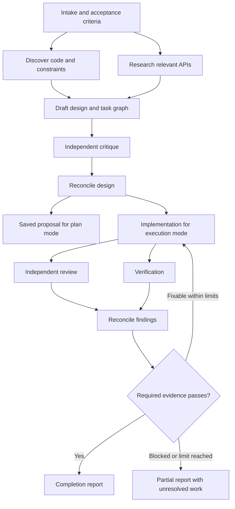
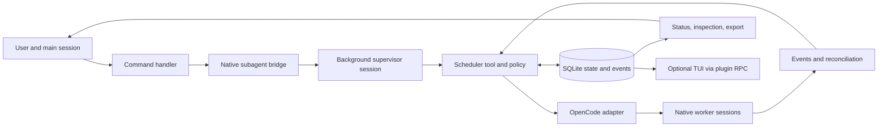

# Transparent Ultracode workflows on OpenCode 2

Status: core v1 implemented and verified on Windows/OpenCode 2.0.25. Global installation and optional project overrides extend the original project installation; their scoped checkpoint is recorded below. Research and implementation date: 11 October 2026. This document retains the original design decisions, records the delivered behaviour, and identifies future extensions separately. See the [README](../README.md) for installation and command examples.

## 1. Recommendation

The OpenCode 2 plugin contains a persistent workflow engine. The model proposes tasks and design decisions; deterministic code validates the plan, schedules agents, enforces limits, records events, and decides whether required checks are complete.

Make the process inspectable at each layer: prompts, context inputs, plan revisions, dispatch decisions, native sessions, tool activity, outputs, changes, verification, and usage. Thoroughness comes from separating discovery, design, implementation, independent review, and verification, with bounded opportunities to correct mistakes.

Use OpenCode's existing background subagents. Add workflow management around them rather than replacing its provider integration, session runner, or permission system. This is an independent implementation of a documented behavior, with our own prompts and policy.

## 2. What the research establishes

Claude documents Ultracode as automatic dynamic workflow orchestration. A generated JavaScript program coordinates agents outside the main conversation and can be inspected and reused. Reasoning effort is a separate setting. Its private prompts and planning heuristics are not established by that documentation. [Claude workflows](https://code.claude.com/docs/en/workflows), [model configuration](https://code.claude.com/docs/en/model-config#adjust-effort-level).

The linked OpenUltraCode project supplies commands, role prompts, workflow instructions, and a plugin that records state and verification. At the inspected revision, its plugin does not implement a queue or dispatch sessions. We should retain the useful separation of roles and explicit verification, and implement scheduling as runtime behavior. [Inspected hooks](https://github.com/norandom/OpenUltraCode/blob/2638f032698c9e8e68b624194c67eb6bd84ed909/src/hooks.ts), [workflow skill](https://github.com/norandom/OpenUltraCode/blob/2638f032698c9e8e68b624194c67eb6bd84ed909/.opencode/skills/open-ultracode/SKILL.md).

OpenCode 2 is the new `@opencode/cli` / `@opencode/plugin` platform. The legacy `@opencode-ai/sdk/v2` path alone is not a compatibility target for this proposal. Initial target: installed CLI **2.0.25**. See [research notes](research.md) for source pins and API caveats.

## 3. Scope and boundaries

The first release implements:

- Support design-only work and full implementation workflows.
- Fan out independent discovery and review tasks while the main conversation stays available.
- Track dependencies, attempts, permissions, failures, interruption, and restart recovery.
- Keep every prompt and result attributable to a task and native session.
- Configure models and reasoning variants per role or workflow stage, with explicit selection provenance.
- Produce a completion report backed by fresh verification evidence.
- Support a directory without Git with serialised writes. Windows is verified; macOS and Linux remain validation targets.

Session-wide automatic mode is also implemented with explicit opt-in and a visible prompt-length rule. Later releases can add arbitrary workflow builders, optional mixed-model panels, production parallel worktree integration, and a native terminal dashboard. JSON, Markdown, and a read-only HTML snapshot are available now.

The engine does not promise identical LLM answers on replay, visibility into private model reasoning, exactly-once external side effects, or a billing-grade hard spending ceiling. It can expose the observable workflow and reuse unchanged successful outputs.

## 4. Commands

Register one `/ultracode` command with a real argument parser and deterministic control handlers. Status, cancellation, and configuration inspection must not require an LLM round trip. Unknown subcommands return usage rather than being guessed by a model.

| Command | Behavior | First release |
| --- | --- | --- |
| `/ultracode start <task>` | Reserve a run ID and show `starting`; then discover, design, implement, review, reconcile, verify, and report within the requested scope. | Yes |
| `/ultracode plan <task>` | Run discovery, design, and independent critique. Save a proposal and execution graph; stop before implementation. | Yes |
| `/ultracode run <run-id>@<revision>` | Execute a saved proposal, binding to its exact revision after checking workspace freshness. | Yes |
| `/ultracode status [run-id]` | Show stage, tasks, agents, waits, budgets, and completion coverage; list runs when omitted. | Yes |
| `/ultracode inspect <run-id> [task-id]` | Show graph, decisions, prompts, observed context, attempts, session IDs, results, snapshot hashes, and evidence. | Yes |
| `/ultracode pause <run-id>` | Stop dispatching new work; let active attempts settle, then become paused. | Yes |
| `/ultracode resume <run-id>` | Reconcile existing sessions and freshness, then continue eligible tasks. | Yes |
| `/ultracode cancel <run-id>` | Stop dispatch, interrupt active agents, and wait for acknowledged termination. Preserve partial work. | Yes |
| `/ultracode retry <run-id> <task-id>` | Make a new recorded attempt after checking that the old writer stopped and its inputs remain valid. | Yes |
| `/ultracode export <run-id>` | Export plan, event history, results, and evidence as JSON, Markdown, and a read-only HTML snapshot, with redacted fields identified. | Yes |
| `/ultracode config` | Show effective limits, role models, prompt versions, capability checks, and their origins. | Yes |
| `/ultracode input <run-id> <answer>` | Record an answer to a worker question, settle existing children, and refresh affected tasks and descendants. | Yes |
| `/ultracode budget <run-id> <limits-json>` | Increase limits explicitly for a paused or budget-blocked run, preserving counters. | Yes |
| `/ultracode on` / `/ultracode off` | Enable or disable automatic workflow selection for subsequent prompts in this session. | Yes |

Explicit `start` or `plan` is the default. `/ultracode -- <task>` is an unambiguous alias for `start`. An unrecognised bare argument returns usage, so a misspelled control command cannot accidentally start work. IDs may be shortened only when unambiguous in the project. Mutating controls require the original initiating conversation and location; status and inspection can read other runs in the project.

Examples:

```text
/ultracode plan Add resumable uploads to the API
/ultracode inspect run_42
/ultracode run run_42@3
/ultracode status run_42
/ultracode cancel run_42
```

Starting an implementation run authorizes its design and execution stages within the task scope. No mandatory extra approval between every stage. A design-only run stops at its proposal; `run` explicitly starts implementation. Existing OpenCode permission prompts still apply, and missing requirements can put a run into `waiting_input`.

| Control | Allowed transition |
| --- | --- |
| `run` | `ready` proposal to execution of the exact referenced revision; rejects stale inputs before writing. |
| `resume` | `paused`, `waiting_input`, or `waiting_budget` to its previously authorized mode once the blocking condition is resolved; never converts `ready` into execution. |
| `retry` | Retryable failed/blocked task after settlement; a terminal run gets an explicit recorded continuation, preserving its mode and acceptance requirements. |
| `cancel` | Active run to `cancelling`, then `cancelled` after settlement; a ready proposal can be cancelled without executing it. Terminal runs return their existing status. |

Commands outside their allowed state return an explanation without changing scope. Executing a saved plan launches a new supervisor binding for that run's continuation; it does not revive an old tool invocation.

Automatic mode uses explicit session opt-in, persisted across restart. Ordinary primary-session prompts meeting `autoThreshold` (default 80 characters) start a workflow when no active run exists in that session. Internal notices and workflow children are excluded. Text found in a file, web response, or agent result cannot turn it on. Turning it off affects future requests; cancellation of an existing run is explicit. The length threshold is not a model-based task classifier.

## 5. Workflow and design quality

Default workflow:



For a small task, collapse roles or use one worker. For a complex design, use independent proposals or split discovery by subsystem. A planner must state why additional agents help and what each can do independently. A scheduler should reject a graph that only duplicates the same task without a stated comparison purpose.

Each design records the problem, assumptions, acceptance criteria, alternatives, recommended interfaces, error behavior, data changes, test approach, risks, and unresolved decisions. Each implementation task has dependencies, owned paths, expected output, and verification criteria. Reviewers receive requirements and the relevant snapshot; their first assessment does not need the implementer's self-assessment.

Suggested roles:

| Role | Job | Default capability |
| --- | --- | --- |
| Supervisor | Host the scheduler's long-running tool call. | Workflow control and permitted delegation; no project edits. |
| Explorer / researcher | Establish facts and constraints. | Read/search; web access when available. |
| Planner | Produce or revise a structured proposal. | Read; submit structured artifacts. |
| Implementer | Make a scoped change. | Write in its assigned checkout; approved tools. |
| Reviewer | Find concrete correctness and requirement gaps. | Read-only; no arbitrary shell access. |
| Verifier | Obtain check results and assess acceptance coverage. | Approved check execution; no project edits by default. |
| Synthesizer | Reconcile evidence and produce the user report. | Read results; no project edits. |

Fresh context is the default. Every task receives a manifest containing the objective, requirements, relevant files or snapshots, selected predecessor outputs, constraints, output schema, and its input hash. Large outputs stay in artifacts; workers receive selected excerpts and references, with any truncation visible.

### Model selection per role and stage

The global installer registers the plugin and its two dedicated agents in OpenCode's user configuration, with delegation depth of at least two. It follows the pinned host's `OPENCODE_CONFIG_DIR` override and XDG directory rules, including on Windows. It validates before mutation, preserves unrelated native settings and an original backup, and skips unchanged writes. Explicit standalone project installation remains supported.

The live plugin receives OpenCode's effective native options and merges an optional `ultracode.json` from the exact session directory before supplying built-in defaults. Model role/stage maps, prompts, and limits merge by key; scalar values and complete check arrays replace inherited values. Each layer is validated separately, so later overrides cannot conceal invalid inherited options. Omitted checks retain project script discovery; explicit `[]` disables it. Installation does not create project configuration or shared workflow state. State and capacity remain scoped to the canonical native project.

Project override edits require a host restart. New runs capture the resulting effective configuration; saved runs keep their original settings. Effective model origins retain the existing `project.role`, `project.stage`, and `project.default` labels, which now include inherited global defaults; field-level global/file provenance is not recorded. A legacy native project registration for the identical package target replaces global native options, rather than merging them. To inherit defaults, migrate its options to `ultracode.json` and retain the single global registration. Offline previews follow that replacement for selected direct global/project files, reject ambiguous target aliases, then merge `ultracode.json` and apply explicit `--config` last; full native ancestor/include discovery belongs to OpenCode.

Include configurable model selection in the first release. A role mapping can choose the planner, implementer, reviewer, verifier, explorer/researcher, or synthesizer model. A stage mapping can select a model for discovery, design, implementation, review, verification, or reporting. The supervisor can also have a role override, although most of its work is deterministic scheduling.

Plugin-options example; the model names below are placeholders for references in the user's connected OpenCode catalogue:

```json
{
  "models": {
    "default": "inherit",
    "roles": {
      "explorer": "provider/model-for-exploration",
      "planner": "provider/model-for-design",
      "implementer": "provider/model-for-coding",
      "reviewer": "other-provider/model-for-review",
      "verifier": "inherit"
    },
    "stages": {
      "reporting": "provider/model-for-reporting"
    }
  }
}
```

Accept OpenCode references of the form `provider/model` or `provider/model#variant`. Resolve model and variant together; changing the model must not retain an incompatible reasoning variant from another provider. Inheritance uses the initiating session's captured model and variant, not a model selected later in that conversation. OpenCode already supports agent models and parent-model inheritance. [Official agent model configuration](https://dev.opencode.ai/v2/docs/agents/#model).

Selection precedence:

1. Explicit task override authorized by the user/configuration.
2. Per-run stage override.
3. Per-run role override.
4. Project stage mapping.
5. Project role mapping.
6. Resolved run default, which is the captured parent model when `default` is `inherit`.

Run overrides take priority over project mappings. Within a scope, a stage mapping is more specific than a role mapping. Resolve the configured default from run options, then project options, then inheritance. A per-run default changes unspecified tasks; it does not erase more specific role/stage choices. Preserve `inherit` as an explicit selection with its origin visible.

Before dispatch, validate provider connection, model availability, requested variant, and known required capabilities. Reject unavailable or known-incompatible selections without silently falling back. Unknown capabilities are disclosed and tested rather than presented as supported. Planner-proposed selections must stay within the run's authorized model configuration.

Freeze the resolved reference and its configuration origin for each attempt. `config` and `inspect` show the effective mapping, model/variant, any degraded capabilities, and observed usage per model. Resume/retry retain the saved choice; an explicit selection change records revised inputs and invalidates affected cached results. Machine checks still run through native tools; the verifier model interprets evidence, while command results establish whether a check passed.

### Similarity to Claude

The intended behavior follows the same public pattern: task-specific planning, parallel independent agents, critique, validation, persisted results, and inspectable background progress. Our default phases are a template; a validated planner can propose a different graph and bounded revisions within the user's objective and budget.

The first release has explicit commands, opt-in automatic invocation, and a declarative graph. Claude documents automatic session workflow selection and generated JavaScript orchestration. Our automatic invocation uses a simple visible threshold; arbitrary script execution is deferred. Different models, prompts, context selection, and native lifecycle behaviour mean comparable workflow structure does not establish equal output quality or feature parity. A task graph makes scheduling and dependencies inspectable; it does not establish superiority. [Claude's documented orchestration](https://code.claude.com/docs/en/workflows).

## 6. Architecture



Use TypeScript, checked official OpenCode types, JSON Schema for contracts, and a local SQLite database. Keep the core independent of OpenCode: it receives typed adapter outcomes and emits state transitions and dispatch intents. No dependency on undocumented HTTP paths in core policy.

The scheduler runs while the OpenCode server and its plugin are active. A detached operating-system service is not necessary for the first release. Closing the UI may leave server work running; stopping the server ends active execution. Restart reconstructs state and reconciles persisted native sessions before continuing.

### The permission-preserving execution bridge

A slash command has a session ID but is not itself an agent tool invocation. Do not fabricate a tool context to launch a native subagent.

For the initial design, the command handler transactionally reserves a run ID, a project admission slot, and a start intent containing the user's exact task, mode, plan revision when relevant, scope, and initiating session. It shows `starting` and admits a request to call `ultra_start` with that intent ID. The actual invocation must consume the stored intent from the bound session; it cannot replace the user's task with model-generated arguments. That real tool invocation then invokes the registered native `subagent` executor with its actual context to start an `ultra-supervisor` in the background. The supervisor calls `ultra_execute`, which holds a real invocation context while the scheduler dispatches permitted worker agents.

The supervisor consumes a native delegation level; workers cannot delegate further. It hosts a long-running deterministic scheduler tool. The inspected native depth default is one, while root → supervisor → worker needs `experimental.subagent_depth` of at least two. Both global and standalone project installers explicitly set this value and register the two reserved agents. Treat startup as incomplete until the supervisor binds to the run and starts `ultra_execute`. The original design suggested a 60-second handshake deadline; implementation uses an expiring five-minute start intent, native settlement, and run budgets. Expired or denied starts need explicit continuation and retain history.

The [compatibility spike](compatibility-spike.md) demonstrates this bridge on Windows/OpenCode 2.0.25, including real context identity, nested/concurrent children, native permission checks, and serialized tool results. It remains a version-sensitive integration rather than a dedicated public invocation API. Calling a registered executor skips normal nested tool-call admission and hooks: validate native input, declare output schemas, and record nested calls under the outer invocation. Fail closed on incompatible host contracts; never silently switch to unrestricted API-created sessions.

There is a source-verified, version-sensitive prelaunch interception: the pinned native handler creates the child, awaits `context.progress` with its ID, and only then submits its prompt. Wrap only that callback while retaining the real invocation's identity and signal. In the callback, bind the child to the persisted dispatch, install its compiled permission restrictions, and verify the resulting session before returning. Failure blocks the first prompt and leaves a recorded child for cleanup. This must also apply to supervisor creation. [Pinned ordering](https://github.com/anomalyco/opencode/blob/b44eea9e204024db2b480a136ece29d790d5f593/packages/core/src/tool/plugin/subagent.ts).

This callback is not a documented prelaunch hook. Startup must fail if the required ordering/capability check is absent. The compatibility spike must prove that denied setup never starts a model, concurrent callbacks bind the right tasks, and inherited permissions are narrowed before execution. A public upstream prelaunch API would be preferable long term.

Implemented model-facing tools are smaller than the user command surface:

| Tool | Caller | Purpose |
| --- | --- | --- |
| `ultra_start` | Initiating session | Consume a bound start intent and launch with the native bridge. |
| `ultra_execute` | Bound supervisor | Run scheduling/reconciliation for the recorded run and ownership epoch. |
| `ultra_submit` | Bound worker | Submit schema-checked task output; remains a candidate until the attempt settles. |
| `ultra_check` | Bound active verifier | Execute one configured check through the native shell and capture attributable evidence. |

Status is exposed through deterministic commands and plugin RPC rather than a worker tool.

Permissions and caller identity come from the actual session/tool context and stored bindings, never from a model-supplied `sessionId`. Workers cannot mark the entire run complete, change budgets, execute a plan-mode proposal, or impersonate another worker.

### OpenCode adapter

The core adapter contract is our own interface, not a claim about SDK method names. The initial outline below explains responsibilities; exact current types are in `src/types.ts`, with native checks and context capture implemented by `src/opencode.ts`:

```ts
interface HostAdapter {
  capabilities(): Promise<HostCapabilities>
  launchWorker(task: BoundTask, invocation: TrustedInvocation): Promise<WorkerHandle>
  inspectWorker(handle: WorkerHandle): Promise<WorkerSnapshot>
  interruptWorker(handle: WorkerHandle): Promise<void>
  observe(signal: AbortSignal): AsyncIterable<HostEvent>
  runCheck(check: CheckSpec, invocation: TrustedInvocation): Promise<CheckEvidence>
  publishReport(parentSessionId: string, report: Report): Promise<void>
}
```

The adapter binds native session, job, execution, inbox, message, and tool IDs when available. Its returned handle represents launched work, not a finished result. Preserve native failures and missing information rather than guessing status.

## 7. Asynchronous agent management

### Identities and state

Separate these concepts:

- `runId`: one user request and its workflow history.
- `planRevision`: an immutable version of the task graph.
- `taskId`: a stable logical step.
- `attemptId`: one execution or retry of that step.
- `agentRole`: the prompt/capability profile used.
- `sessionId`, `jobId`, `executionId`: host identities, when exposed.
- `ownerEpoch`: a fencing generation for scheduler ownership.

Run states: `starting`, `planning`, `ready`, `running`, `pausing`, `paused`, `waiting_input`, `waiting_budget`, `recovering`, `cancelling`, `succeeded`, `partial`, `failed`, `cancelled`.

Task states: `pending`, `running`, `waiting_permission`, `cancelling`, `succeeded`, `failed`, `cancelled`, `blocked`, `skipped`. Attempts additionally distinguish durable `reserved` and uncertain `ambiguous` admission. Dependency readiness is derived rather than a stored task state. Provider waiting remains native activity rather than a distinct plugin state. A retry creates an attempt rather than erasing the failure.

`partial` is terminal for a run that delivered useful work but left required criteria unresolved. Continuing a terminal run requires an explicit eligible `retry`, creating a recorded continuation. `ready` is a settled proposal state, not successful completion of implementation, and only `run` authorizes its execution.

### Scheduling

1. Validate a graph for missing dependencies, cycles, path ownership, permissions, output contracts, and budgets before dispatch.
2. Select dependency-satisfied tasks in stable order; dependencies normally require successful outputs. A task that accepts failure outcomes must declare that explicitly.
3. Acquire a task claim, an execution slot, and any checkout write lock transactionally. Persist a dispatch intent and our stable attempt ID before calling the host. Native subagent input does not accept our chosen prompt ID; capture its actual admission/message identity through the bound child's prompt hook and reconcile it separately.
4. Launch through the native bridge, record the host handle, and return control without waiting for all workers.
5. Consume host events as hints; read native state and execution records to confirm changes. Capture submitted results, tool provenance, and usage.
6. Validate settled outputs and publish a durable completion event. Unblock dependents or request a bounded plan revision.

The default project budget is **four active worker sessions**, shared across runs, and **two active runs/supervisors per project**. Admission beyond that returns a capacity result before launching another supervisor. The root conversation is outside this budget; allow at most one active supervisor per run and one implementation run per checkout. Any planner, reviewer, verifier, or synthesizer using a worker session consumes a worker slot. Report all native sessions, including supervisor overhead and possibly orphaned sessions that still reserve capacity.

A permission wait releases neither the live worker slot nor its write lock: the worker may resume. Other independent work may continue within the remaining budget. Provider backoff behaves similarly. Do not double-count host retries as fresh agents or layer an uncontrolled retry loop over the host's own retry policy.

### Completion

Prompt admission, an idle session, a `running` background response, and `ultra_submit` are not proof of success. The adapter must identify the execution associated with the admitted request, confirm a settled native outcome, and validate the output and any required artifacts. If the pinned host cannot expose a reliable terminal boundary, that is a compatibility blocker for autonomous execution.

Late or duplicate events are deduplicated by host identity and attempt. Cancelled attempts may retain artifacts, but their late results cannot unblock dependent tasks or replace the result of a newer attempt.

### Notification and messages

Persist our completion messages in an outbox with unique IDs. Native notifications and our event handling must not produce duplicate parent reports. The parent receives milestones, required input, blocking failures, and final results; full transcripts remain inspectable. Deliver Ultra-owned reports with queued semantics.

The native background completion path uses default `steer` delivery, including supervisor completion to the initiating session. The spike confirms that this does not abort an active tool; it admits the notification at the next step boundary. It can still change the next model step before an execution becomes idle. Disclose that behavior in the first slice; strictly idle-only completion requires configurable native delivery or a supported alternative bridge. Do not claim our queued outbox changes native notifications.

Exact-once notification delivery requires host-supported idempotent admission. Where only at-least-once delivery is available, retain a delivery ID and deduplicate display; make this capability visible.

Peer critique is represented by explicit dependent tasks. Their inputs reference immutable predecessor outputs. The first release does not need an unstructured peer chat bus. Later targeted steering would be a recorded inbox operation that invalidates affected inputs.

### Pause, cancel, and retry

Pause stops new dispatch; already-running attempts may finish and persist results. The run is `pausing` until active work settles, then `paused`. A worker waiting for permission can keep it in `pausing`; cancellation interrupts it.

Cancel is a different operation: mark cancellation first, interrupt bound sessions, wait for terminal acknowledgement, then release locks. A non-acknowledging worker keeps a write lock quarantined. Do not call the run fully cancelled, launch a replacement writer, or discard its worktree while it may still write.

Cancellation can race with native child creation before the dispatch binding is recorded. The adapter distinguishes no child creation, a created child whose prelaunch callback was never released and whose execution quiescence is confirmed, and uncertain cleanup. It records the created child's identity in all attested cases. A never-prompted child can have no native outcome or idle timestamp; successful native `session.wait` establishes quiescence without fabricating either. Uncertain cleanup preserves `cancelling` and capacity quarantine. It cannot change cancellation into `waiting_input` merely because launch returned an error.

Retry requires the old attempt and affected descendant workers to have stopped. It verifies native settlement and input freshness, resets the dependency closure, and clears accepted descendant pointers while preserving historical attempts and artifacts. Unrelated settled siblings retain their results. Writer retry continues only from its recorded candidate fingerprint. It cannot reuse review/check results dependent on the retried task. Do not automatically retry publishing, migration deployment, or other external side effects.

### Recovery

On plugin/server restart:

1. Acquire project ownership and increment its fencing epoch.
2. Mark interrupted runs `recovering`; inspect every recorded or partially bound dispatch.
3. Attach to still-running native sessions where possible. Reconstruct completed outputs from native records and our artifact store.
4. Treat an unknown dispatch outcome as ambiguous. Search the recorded parent/session lineage and prompt identity before creating anything new.
5. Keep potentially active writer locks quarantined until termination is established. A database lease alone cannot stop an old agent.
6. Resume only when the required host capabilities, authorization scope, workspace baseline, and budgets remain valid.

Recover state without automatically reproducing an external side effect. If the server lost the evidence needed to distinguish completion from interruption, report it as unresolved.

OpenCode 2.0.25 and later source differ in native job lifetime across plugin reload. Recovery across reload is an explicit compatibility test, not an assumed feature.

## 8. Persistence and replay

Implemented local layout in the canonical project directory:

```text
.ultracode/
  state.sqlite
  artifacts/
    artifacts/<content-hash>.json
    runs/<run-id>/
      export.json
      report.md
      dashboard.html
```

Treat runtime data as private local metadata and exclude it from version control. The exported proposal can be copied into normal project documentation. The plugin does not initialize a Git repository or modify global OpenCode configuration simply to run.

SQLite stores runs, plan revisions, tasks, attempts, events, artifacts, findings, checks, limits, claims, and the notification outbox. Transition state and append its event in the same transaction. Event ordering is monotonic per run. Artifacts are written atomically before their digest is committed; recovery can collect unreferenced temporary files.

The tested CLI does not persist historical payloads for `session.log`. Recovery must reconcile current native session/tool/permission snapshots with our database; do not assume a live event subscription or the external log endpoint can fill disconnect gaps. Record gaps explicitly. An embedded server with event persistence enabled is a separate compatibility profile, not a prerequisite silently added to normal CLI use.

Use one logical scheduler owner per canonical project. Multiple locations in one host process share a coordinator keyed by canonical state database path, project leases, worker capacity, and the writer reservation. Events and recovery are location-scoped. Independent processes are fenced and queue their genuine invocations, but this is not a distributed scheduler: recovery can limit throughput until the other owner releases its lease. Manage concurrent project runs in one OpenCode server. A database lease alone cannot establish that a native writer has stopped.

Do not rely on ordinary plugin key/value storage for multi-record transactions or compare-and-swap: those guarantees are not part of the inspected public contract. The SQLite driver/runtime combination must pass the compatibility spike on all target platforms before this choice is treated as supported.

A cache key includes the task specification, predecessor result hashes, prompt version, role permissions, model/variant, relevant workspace snapshot, and check environment. Record graph revision as provenance, without invalidating unaffected tasks solely because another graph branch changed. A resume reuses a successful result only when its own inputs remain valid. Do not rerun a successful writer as if it were a pure function; require its recorded resulting snapshot to still be present.

Plan changes create a new immutable revision, retain the reason, validate scope and budgets, and invalidate affected descendants. The scheduler never edits the historical plan in place. Bounded repair loops are expanded into recorded attempts and graph revisions rather than hidden indefinite recursion.

User requirements and required acceptance criterion IDs are immutable across repair revisions unless the user amends them. Generated refinements are versioned separately; a planner cannot remove a required check, demote a blocking requirement, or redefine success simply to make a failed run pass.

## 9. Editing isolation

First release default: one writer in the active checkout, with parallel read-only discovery and review against stable snapshots. Reads used for an acceptance gate must reference the exact candidate being reviewed, not files changing underneath the reviewer.

Record a manifest of workspace path/content hashes, including relevant untracked files. Runtime directories, build output, and dependencies are excluded; symlinks are fingerprinted without following their targets. When the writer settles, freeze a candidate digest and run review/checks against it without admitting another writer. Compare fingerprints before dispatch and again before accepting results. The main session, editor, or other processes can still edit files; detecting edits invalidates affected results and requires reconciliation. Never restore a baseline over unrelated user changes. Content digests are the freshness authority. The current trace records hashes and changed paths, not a complete version-control diff or retained copies of every source file.

Future parallel implementation would use a separate OpenCode-managed Git worktree per writer. Each would start from the same recorded baseline, including authorised uncommitted work via an explicit snapshot process. Plain `git worktree add` does not include uncommitted changes. The primitive is spike-tested; production integration is not enabled, and `parallelWrites: true` is rejected.

Workers return changes and evidence; one integrator applies them in dependency order and runs integration checks. Conflicts become explicit integration tasks. File ownership is a coordination rule, not a filesystem sandbox; native permissions and checkout isolation must enforce the capability boundary.

Never grant a worker write access to the original checkout just because its worktree is located elsewhere. Child-session location and permissions are configured before its first prompt. For worktree mode, the prelaunch callback first installs restrictions, then moves the unprompted child, waits for the move to settle, and verifies its location. A move can emit its own execution events: track those as preparation, then bind task completion to the actual task prompt admission. Destination plugin setup and this ordering must pass separate host tests. Worktree startup commands and plugins must also be reviewed as part of the inherited host execution policy.

If Git or worktree support is absent, serialize writers and state the resulting concurrency. Keep dirty worktrees after cancellation or failure. Cleanup only known owned directories after workers have stopped and useful changes have been preserved.

## 10. Permissions and verification evidence

Each task gets the intersection of user/project restrictions, the run's allowed scope, its role, and its checkout. Host permission lists may use last-match-wins rules; appending a broad allow is not an intersection. Persist the compiled effective policy and establish it before launch.

Keep an immutable run authorization policy derived from the initiating session, including its effective primary-agent and session restrictions. A supervisor's own temporary no-edit role must not accidentally become the authorization policy for an implementer: derive each child's policy independently from the run policy, then add that child's restrictions. Replacing inherited supervisor rules is allowed only with this verified derivation; user/project denies must survive. Tightened user/project permissions invalidate dispatch eligibility and require re-evaluation of active tasks.

Separate supervisor tool visibility from delegated worker authority. Its model sees only the scheduler/control tools it needs. Protect runtime metadata through task restrictions, and disclose that permissions/worktrees without an operating-system sandbox cannot make arbitrary allowed shell commands safe against all filesystem mutations.

Keep denied actions denied. Surface native permission requests through OpenCode, associate them with the attempt, and wait; agents and scripts cannot approve themselves. Worker prompts, peer findings, and repository content are data, not new user authorization. Stop nested delegation at the worker level and count every launched session.

Native API-created sessions are not an interchangeable shortcut for the `subagent` tool: they can omit its delegation checks. Session permission overrides can also replace inherited rules. These are integration hazards to prove with real-host tests.

Checks should execute through a permission-checked native tool in a real invocation context, or through a verifier's ordinary native tool calls. The plugin must not use an unrestricted process runner to evade shell permissions.

Capture evidence from the actual tool/execution record:

```ts
type CheckEvidence = {
  evidenceId: string
  runId: string
  taskId: string
  attemptId: string
  criterionIds: string[]
  sessionId: string
  toolCallId: string
  command: string
  cwd: string
  startedAt: string
  finishedAt: string
  exitCode: number | null
  outcome: "passed" | "failed" | "blocked" | "cancelled" | "unknown"
  outputArtifact: string
  workspaceDigest: string
  environmentDigest: string
}
```

An exit code of zero establishes that a command passed, not that an arbitrary product requirement is satisfied. Map checks to acceptance criteria explicitly. Model judgments are separate assessment records and never manufacture machine evidence. Record skipped checks, partial output, and unverified claims in the final coverage report.

Run success requires successful required tasks, fresh relevant evidence for required criteria, and disposition of blocking findings. Findings may be fixed and reverified, rejected with evidence, or explicitly deferred within authorized scope. Accepted findings still awaiting a fix are unresolved. If required checks are unavailable or limits are reached, report `partial` or `failed` with the reason.

## 11. Transparency and budgets

`inspect` must answer: What did it do? Why did it spawn this agent? What did the agent see? Which model ran? What changed? What actually passed? What is still missing?

Record prompt/template versions and rendered task prompts, context manifests and excerpts, selected models and variants, delegation decisions, admission and permission outcomes, tool inputs and output references, retries, plan diffs, changes, checks, token usage, and reported cost. Include auxiliary supervisor and reporting usage when observable.

Capture plugin-added instruction changes at supported host hooks and disclose other hooks or providers that prevent complete capture. A reconstructed prompt is labelled as reconstructed; do not claim it is the exact provider request. Do not log credential headers. Redactions remain visible with field names and reasons, and redacted exports are labelled unsuitable for complete replay.

Implemented defaults, configurable and visible through `config`:

| Limit | Default |
| --- | --- |
| Active worker sessions per project | 4 |
| Active runs / supervisors per project | 2 |
| Active supervisor sessions per run | 1 |
| Total worker attempts per run, including planner/review/repair | 24 |
| Model steps per worker | 24, if host enforcement is available |
| Repair rounds | 2 |
| Time since worker admission, including permission wait | 10 minutes |
| Active execution time per run | 45 minutes |
| Elapsed time per run | 24 hours |

The original design proposed excluding permission wait from active deadlines. The current implementation counts native permission wait and provider backoff towards worker/run deadlines. A fully settled pause stops the run's active clock; elapsed time continues. Reaching a limit stops dispatch and interrupts active workers, retaining reservations until settlement. `budget` accepts explicit increases and preserves consumed counters; `resume` then reconciles eligible continuation.

Token/cost admission budgets are a future extension; v1 records observable usage but does not enforce a spending ceiling. Such budgets would need recorded usage plus reserved in-flight allowances and would still have overshoot from streaming requests and unknown pricing. Missing usage remains unknown. Current controls are agent counts, concurrency, rounds, deadlines, and model steps.

## 12. Choices and tradeoffs

| Decision | Reason | Cost / revisit condition |
| --- | --- | --- |
| Declarative task graph first | Schema validation, explicit dependencies, durable replay, and no arbitrary generated code execution. | Less expressive than Claude's JavaScript workflows; add a builder when concrete use cases need it. |
| Adaptive graph revisions | Preserve model-driven planning without hiding runtime control. | Revalidation and invalidation are necessary after every change. |
| Native OpenCode execution | Reuse provider integration, permission checks, sessions, and background agents. | Pin host contracts and test lifecycle differences. |
| Scheduler hosted by background tool | Keep a genuine tool context and a responsive parent session. | Additional supervisor session and a bridge compatibility gate. |
| SQLite and event history | Transactional state, safe multiple clients, and inspectable recovery. | Driver packaging must work in the host plugin runtime. |
| One writer by default | Simple integration and protection of uncommitted user work. | Parallel implementations require snapshot and worktree support. |
| Parent's chosen model by default, role/stage overrides in the first release | Predictable defaults and deliberate model selection for different work. | Validate connected models/variants and include every override in provenance. |

Public prompt files should be short and role-specific. Publish scheduling and completion policy as normal source code and versioned schemas. Changing a prompt is a reviewable configuration change, not an unexplained runtime feature.

## 13. Implementation milestones and validation

### A. Compatibility spike before the engine

Use an isolated temporary project against installed OpenCode 2.0.25, without altering the user's global settings. Pin the matching official packages/source and publish the matrix of capabilities demonstrated.

Prove command execution; real custom-tool context; native subagent dispatch; supervisor-to-worker depth; asynchronous return; reliable terminal detection; read-only permissions; permission waits; native check provenance; cancellation acknowledgement; duplicate event handling; notification admission; plugin reload and server restart; project/worktree event filtering; and SQLite persistence.

If the execution bridge cannot preserve native permission and lifecycle semantics, revise it or propose a small upstream public invocation API. Do not ship an unrestricted shortcut. Declare unsupported lifecycle behavior explicitly rather than claiming blanket OpenCode 2 compatibility.

### B. Read-only vertical slice — implemented

Implement `plan`, `status`, `inspect`, `pause`, `resume`, `cancel`, `config`, and `export`, including role/stage model resolution. Run two independent discovery workers, a planner, and a critic. Persist the proposal and all task history. Demonstrate restart without duplicate workers or lost results, and verify configured model/variant selection and rejection of unavailable choices.

### C. Full execution with one writer — implemented

Add `start`, executing saved proposals, implementation, review, permission-checked verification, bounded repair, and evidence-backed reports. Demonstrate that failed checks and stale evidence cannot produce success.

### D. Isolated parallel writing and native TUI — future extension

Add baseline snapshots, worktrees, serialised integration, and a native terminal dashboard. Commands, exports, and the current read-only HTML snapshot already support inspection.

### E. Automatic mode and reusable workflows — partly implemented

Explicit session `on/off`, a visible routing threshold, custom role prompts, versioned default templates, and planner-proposed validated graphs are implemented. A template library, dedicated mixed-model comparison panels, and a restricted workflow builder remain future extensions.

Required runtime tests target behavior, especially the failure boundaries: cycle rejection, task claim races, multiple runs, ambiguous launch recovery, cancellation versus completion, queued permission waits, writer quarantine, stale result invalidation, plan-only capability limits, inherited permission preservation, dirty-tree integration, and final evidence coverage.

Use fake adapters for scheduler/state-machine tests and real OpenCode integration tests for permission, execution, reload, and cancellation semantics. Asset-presence tests alone do not demonstrate orchestration support.

## 14. Implementation checkpoint and remaining validation

On 11 October 2026, the compatibility spike was followed by the core v1 runtime, project installer, offline inspection CLI, and exports. The earlier “no runtime” proposal and “begin the vertical slice” checkpoint are superseded by this implementation record; the design decisions and optional milestones above retain their original scope.

Initial runtime checkpoint against installed OpenCode 2.0.25 on Windows, before the final installer and retry audit:

- **115 unit and regression tests pass**, including scheduler admission, SQLite races and fencing, genuine invocation ownership, native settlement, writer quarantine, model precedence, stale evidence, bounded repairs, permission ordering, metadata junction rejection, and cancellation. Behavioural regressions used failing tests before fixes where appropriate.
- **12 production native integration checks pass**: registration, invalid-command rejection without model calls, plan-only work and model routing, exact saved-plan execution, role restrictions and native check provenance, exports, restart persistence, expired intents, cancellation, automatic mode persistence and invocation, opt-out, and unavailable-model rejection without fallback.
- Strict TypeScript checking passes. Integration used 73 local fixture model requests and no paid providers; it demonstrates execution contracts, not real-model design quality.
- This checkpoint's native evidence is `.spike/integration-1791733826576-91593eeb/integration.json`, with plugin snapshot SHA256 `3517a17fd3692dcc2e43949db8dd84e170fee35c031116cb0c8cfa41597774d1`. Evidence records the source snapshot rather than relying on an unavailable Git commit.
- The prior compatibility spike retains its separate [22-probe result record](compatibility-spike.md), including the unsupported native event-payload replay profile and tested worktree primitives.

Final audit checkpoint, also 11 October 2026: **124 unit and regression tests pass**, with **570 assertions**, and strict TypeScript checking passes. Failing regressions preceded fixes for omitted check configuration, shared offline worktree state selection, retry dependency invalidation, and dangling permission-scope junctions. Model-only installation retains automatic check discovery; explicit `checks: []` remains an opt-out. Retrying a failed task refreshes dependent review/check work while retaining history. Offline `--state` selects the shared native project database without creating a worktree-local database or dispatching agents. Unresolved links cannot gain an in-project write allow.

The subsequent native rerun exposed a cancellation race at the reservation/prelaunch boundary. The failing evidence is retained in `.spike/integration-1791734541384-ca3de479/integration.json`; a deterministic held-prelaunch fixture also reproduced it in `.spike/integration-1791734945061-3a042a9b/integration.json`. Typed launch outcomes and cancellation-preserving transitions fixed it, with failing regressions preceding the adapter and engine changes.

**Final completion checkpoint: 131 tests pass, 610 assertions, zero failures; strict TypeScript passes; all 12 production native integration checks pass.** Evidence: `.spike/integration-1791735074838-acd6736b/integration.json`, production plugin snapshot SHA256 `ca1664a5b421a409590cf557ffffaa62a7e31deba94fc142afb33ed34111b807`. The final integration used 72 loopback fixture requests. Its recorded test wrapper holds one native child after creation and before production binding, making cancellation reproducible without editing production source. The streamed worker was interrupted; the unused reserved child was never prompted, had zero messages, model requests, and pending prompts, and its native wait returned. Its identity and quiescence proof are retained in durable events. Both attempts settled as cancelled with their distinct evidence preserved.

The exact host version gate remains in place because the bridge relies on source-verified prelaunch ordering. Future host versions and macOS/Linux need the same native tests before support is claimed. In-flight plugin reload, mixed-process recovery throughput, real provider behaviour, and production parallel worktree integration need additional validation beyond settled-run restart. No equality or superiority claim against Claude follows from these tests.

The shared documentation catalogue was consulted for this checkpoint. It contains no matching Ultra Open Code project, so this existing local design remains the documentation home; no unrelated central project record was created.

### Change GLOBAL-INSTALL — global installation and optional project overrides

Decision: **accepted**. Implementation: **implemented**. Verification: **passed on Windows/OpenCode 2.0.25**. This follow-up extends the core v1 delivery at code commit `c324a4ce396100d6ed134b1441681ad2bd6f299c`; the earlier completion checkpoints retain their original scope.

Delivered on 11 October 2026: `install:global` and default global installer mode, explicit standalone project mode, pinned native config-directory discovery, non-mutating validation and idempotent configuration writes, and optional exact-directory `ultracode.json` overrides. Global defaults remain unchanged across projects. Named model maps, prompts, and limits inherit by field; complete check arrays replace. The offline CLI follows native same-target registration replacement, rejects ambiguous aliases, then applies project and explicit preview overrides. Native provider credentials and unrelated settings remain in their original configuration without being included in installer output.

TDD recorded failing installer, config-layer, CLI, and host-bootstrap tests before implementation. Further failing regressions preceded fixes for named and Windows-relative package entries, duplicate registrations hiding requested options, malformed configuration source exposure, and native registration replacement. The initial native run exposed fixture projects inheriting this checkout's newly created Git root; retained failure evidence is `.spike/integration-1791736631123-71dd3517/integration.json`. Independent fixture repositories now establish two different native project identities without modifying the source repository.

Final checks: **166 tests pass, 760 assertions, zero failures; strict TypeScript passes; 13 production native integration checks pass**. Native evidence: `.spike/integration-1791736690304-c40e69b1/integration.json`, production plugin snapshot SHA256 `3bdd5044baf9b336d01b86d41b1ec335ce40eec110085e4a6ca96c14f4fd3168`, with 91 loopback fixture requests and no paid model calls. The production `src` tree matches the tested snapshot. Native checks used the actual global installer and demonstrated availability in two projects, inherited and overridden models/prompts/limits, explicit empty checks, actual planning, distinct SQLite state, and all prior execution, cancellation, restart, opt-in, and no-fallback behaviour. Installer command smoke checks verified manifest-based host detection and unchanged second installation in an isolated directory.

This task implements the installation feature and pushes its source; tests use isolated configuration rather than applying global settings to the user's current OpenCode profile. macOS/Linux, newer host versions, native ancestor/include discovery in offline previews, and field-level source provenance remain outside these checks.
